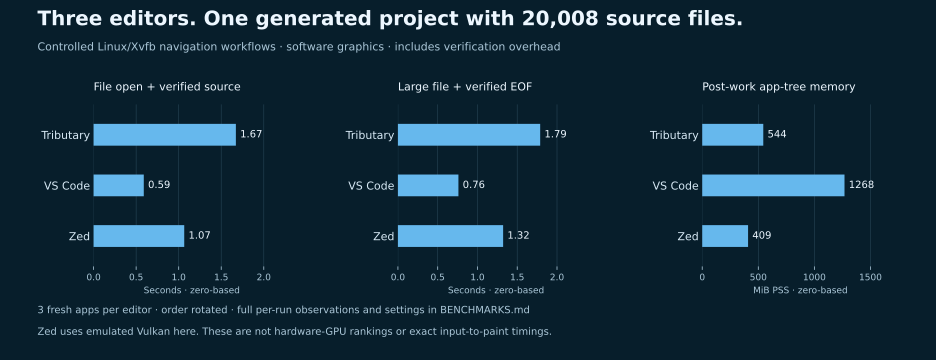
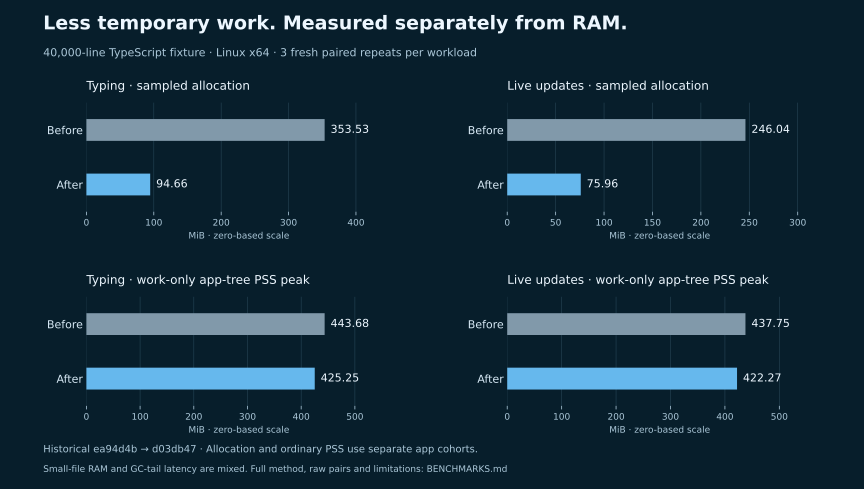

# Benchmarks

Measure a specific workload. Keep allocation traffic, retained heap, process memory and bundle size separate.

## Cross-editor large-project navigation

Tributary, VS Code and Zed run the same generated project with **20,008 TypeScript files** and a **40,001-line source file**. Three fresh instances per editor run serially in rotated order. Each instance opens six distinct small files and verifies the complete source; the large-file task verifies the first and final nonempty lines using native keyboard navigation. Process memory is sampled separately after the work.

| Editor | File open + source verification, median | Observed file-open range | Large file + EOF verification, median | Post-work app-tree PSS, median |
| --- | ---: | ---: | ---: | ---: |
| Tributary | 1.67 s | 1.37–9.58 s | 1.79 s | 544 MiB |
| VS Code | 0.59 s | 0.48–0.63 s | 0.76 s | 1,268 MiB |
| Zed | 1.07 s | 0.87–1.24 s | 1.32 s | 409 MiB |

**Observed:** VS Code completed these navigation workflows faster; Zed used less app-tree PSS. Tributary’s first measured file search took 9.58 seconds; it is retained in the range and raw data. This comparison identifies work to improve, rather than establishing that Tributary is faster than other editors.

**Environment:** Linux x64, Intel Core i5-1235U, 12 logical CPUs, about 15.3 GiB RAM. VS Code 1.130.0 (`1b6a188`), Zed 1.26.2 (`c427327`), Tributary source based on `f29163f` plus the exact dirty-source fingerprints in the report; Node 24.21.0. The report preserves source-file hashes and the complete UI build hash, so the base commit alone must not be used to reproduce the measured implementation.

**Method:** all nine fresh instances passed; 18 small-file observations and three large-file observations per editor. PSS is the median of each instance’s accepted post-work samples, then the median of three instances. All 45 process-tree observations were complete; none were rejected. Same-buffer verification controls had medians of about 61 ms in each editor and are included without subtraction. Files are tracked in a clean Git fixture. App profiles and themes are explicit; AI and external language servers are disabled as detailed in the method.

**Limits:** Linux/Xvfb software graphics, including Zed’s emulated Vulkan renderer. Image/clipboard verification and 120 ms settling observations are included. These are coarse workflow measurements, not precise input-to-paint latency, cold startup, semantic language-server throughput or hardware-GPU rankings. Three instances and an ordinary desktop host do not establish statistical confidence. Process-tree accounting excludes display-server memory, GPU VRAM and detached/reparented external helpers.

[Method, settings and reproduction](docs/performance/EDITOR_COMPARISON.md) · [Every operation, source identity and process sample](docs/performance/editor-comparison.json). The earlier focus-failure cohort is retained separately and is not pooled into these results.

The later asynchronous file-reader, project ESLint and formatter-selection changes postdate this frozen cohort. The table does not measure their latency or memory cost; functional validation is documented in [Project ESLint](docs/PROJECT_ESLINT.md).

## Historical Tributary allocation comparison

These results come from a **frozen historical comparison**, baseline `ea94d4b` versus the allocation implementation committed as `d03db47`. They do not measure the current release’s complete feature set or another editor.

| Large-file workload | Baseline | Optimized | What was measured |
| --- | ---: | ---: | --- |
| Typing | 353.53 MiB | 94.66 MiB | Sampled renderer allocation estimate |
| Live disk updates | 246.04 MiB | 75.96 MiB | Sampled renderer allocation estimate |
| Typing | 443.68 MiB | 425.25 MiB | Work-only app-tree PSS peak |
| Live disk updates | 437.75 MiB | 422.27 MiB | Work-only app-tree PSS peak |

**Environment:** Linux x64, Intel Core i5-1235U, 12 logical CPUs, about 15.3 GiB RAM. The raw report records Electron/V8/Node versions and source/build hashes. **Method:** 48 serial fresh apps; separate cohorts for allocation sampling, natural GC tracing and ordinary memory. Three paired repeats for each mode/workload, with the middle pair’s order reversed. Both 40-line and 40,000-line tracked TypeScript files; 60 real editor changes or 32 real disk writes, with exact final-text and native undo/redo checks.

**Limits:** descriptive medians, not statistical proof of universal gains. PSS sampling is requested every 100 ms and can miss short peaks; incomplete observations are rejected and retained in the archive. Starting PSS varies. Small-file RAM results are mixed. Typing’s traced per-run p95 observable GC pause changes from 8.75 to 8.93 ms; live-update p95 changes from 7.63 to 6.32 ms. Reduced allocation is not proportional RAM or latency reduction. No GPU, provider inference, installed macOS/Windows or competitor comparison is claimed.

[Full method and interpretation](docs/performance/EDITOR_WORKING_SET.md) · [Machine-readable pairs](docs/performance/editor-working-set.json) · [Raw profiles, traces and process samples](docs/performance/editor-working-set.diagnostics.json.gz) · [Bundle audit](docs/performance/editor-working-set-bundles.json)

A later CRLF correction and this README/sidebar/release update are outside that frozen timing/RAM comparison. Their functional checks do not refresh its performance claims.

## Run a benchmark

Install the root and UI dependencies first. Regenerating the optional documentation chart also requires Python 3 and Matplotlib in your development environment; neither is an app dependency. Use the same runtime, inputs and dependencies for both sides. Run timing/memory experiments serially without concurrent builds, tests, agents or profiling tools. Write new results to `/tmp` first; publish them only with their source identity and scope.

| Area | Command | Scope |
| --- | --- | --- |
| Saved streaming history | `npm run bench:stream -- --output /tmp/stream.json` | Synthetic Node save latency and serialized bytes; not UI latency |
| Appearance packs | `npm run bench:appearance -- --output /tmp/appearance.json` | Synthetic catalog/cache behavior; see script’s fixture |
| Local request admission | `npm run bench:local-requests` | Queue/ownership behavior; not model-token throughput |
| Terminal transport | `npm run bench:terminal` | Bounded transport and byte correctness; not GPU memory |
| Language-server framing | `npm run bench:lsp` | Parsing/copy and retention diagnostics; not live server performance |
| UI import boundaries | `npm run bench:bundles -- --output /tmp/bundles.json` | Temporary production builds; historical import-boundary experiment, not full old app |
| Editor working set | `npm run bench:editor-working-set -- /absolute/frozen-baseline /tmp/editor.json` | Linux procfs + Xvfb + built frozen baseline required |
| README chart | `npm run bench:chart` | Regenerate the chart from the checked-in report; no timing experiment |

The benchmark scripts describe their own fixtures and any diagnostic collection. Production does not force garbage collection. Some Node memory diagnostics use explicit collection in isolated workers; never describe those results as ordinary desktop RAM.

For the full native editor reproduction, including preparation of the baseline, read [the experiment instructions](docs/performance/EDITOR_WORKING_SET.md#reading-and-reproducibility). `bench:bundles` restores selected historical import boundaries against current dependencies and is a different experiment from the editor bundle audit linked above.

## More evidence

- [Memory ownership and budgets](docs/MEMORY_EFFICIENCY.md): history, worker, local-request, terminal and cache lifetimes.
- [Research log](docs/MEMORY_OPTIMIZATION_RESEARCH.md): author/primary-source reading, what was inspected and what remains open.
- [Writer histories](docs/performance/WRITER_HISTORY_OWNERSHIP.md): distinguish ordinary PSS from diagnostic retained heap.
- [Local engine](docs/performance/LOCAL_ENGINE.md): isolation and admission; model weights remain in the external runtime.
- [Performance scripts](scripts/performance): reproducible probes and raw-report generators.

## Add a result

Record the exact commits and dirty-file hashes, runtime, OS, hardware, complete inputs and build hashes. Preserve every paired run and failed/rejected observation. Check output correctness before accepting a number. Report warm-up, sampling interval, run order, repetition count and profiler/forced-GC effects. Keep microbenchmarks separate from end-to-end claims and keep unfavorable results visible.
