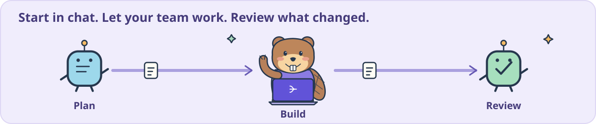
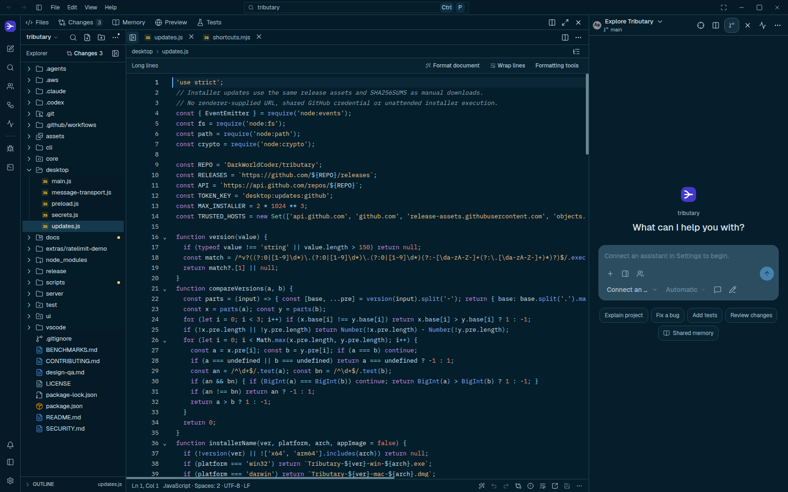
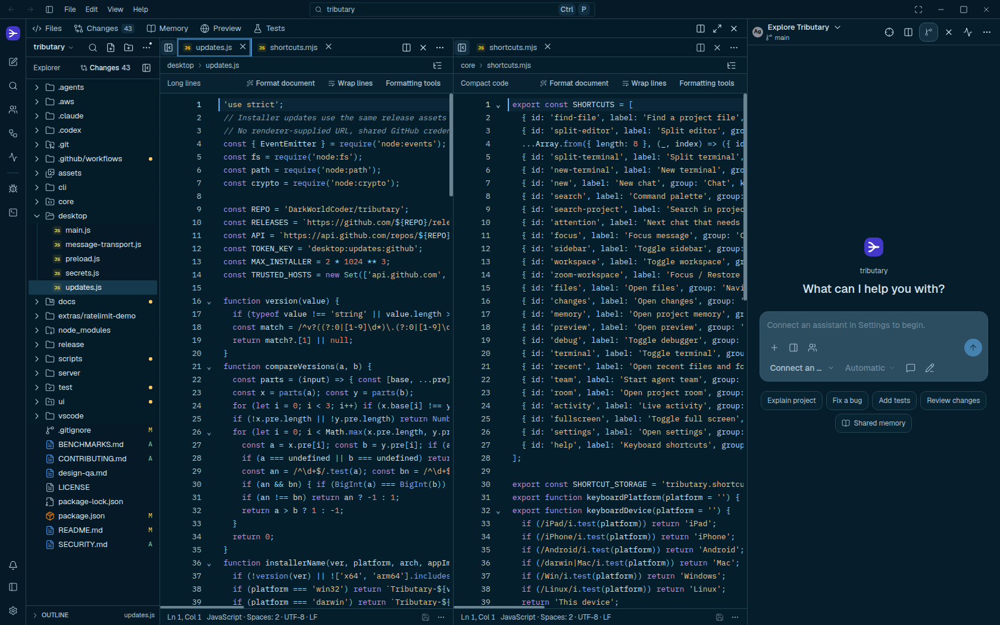

<p align="center"><strong>Your agents. Your files. One workbench.</strong><br>Build, test, research and create with the assistants you already use.</p>

<p align="center"><a href="https://github.com/DarkWorldCoder/tributary/releases"><strong>Download Tributary</strong></a> · <a href="#get-started">Quick start</a> · <a href="#what-can-you-do">Use cases</a> · <a href="docs/GUIDE.md">Guide</a> · <a href="CONTRIBUTING.md">Contribute</a></p>

<p align="center"><a href="LICENSE"></a>  </p>

<p align="center"><sub>Original animated SVG artwork. <a href="docs/media/tributary-flow-static.svg">Prefer a still illustration?</a></sub></p>

## Get started

1. **[Download a preview](https://github.com/DarkWorldCoder/tributary/releases)** for your computer.
2. **Open a project** or start a writing, learning or research task.
3. **Connect your assistant** in **Settings → Connections**, then start chatting.

<details>
<summary><strong>Installers, updates and local models</strong></summary>

| Your computer | Downloads |
| --- | --- |
| macOS · Apple Silicon / Intel | `.dmg` installer, `.zip` containing the app |
| Windows · x64 / Arm64 | `.exe` installer, portable `.zip` |
| Linux · x64 / Arm64 | `.deb`, `.AppImage`, `.tar.gz` |

Preview builds are unsigned/not notarized. Check the release’s `SHA256SUMS.txt`. Packaged apps include their runtime; Git is needed for repository features. Downloads require repository access while the repository is private.

Already installed? **Help → Check for updates**. Preview downloads are on Releases; GitHub’s “latest release” shortcut excludes previews.

[Install or uninstall](docs/UNINSTALL.md) · [In-app updates](docs/APP_UPDATES.md) · [Set up Ollama, LM Studio, Unsloth or llama.cpp](docs/LOCAL_MODELS.md)

</details>

## What can you do?

| You want to… | Make it happen in Tributary |
| --- | --- |
| **Build a feature or fix a bug** | Ask a coding agent to inspect, edit and test the real project. Follow its file changes in the editor. |
| **Refactor or understand a codebase** | Explore files, ask for explanations and plan changes before editing. Include context with `@` file mentions. |
| **Work on several folders** | Open a multi-folder workspace, search files, split editors and move between projects. [Editor groups](docs/EDITOR_GROUPS.md). |
| **Review and undo changes** | Inspect Git diffs and red/green line counts, review agent edits and use editor undo/redo or supported change checkpoints. |
| **Run a project** | Use terminals, project scripts and checks; open the app in the preview browser. [Project checks](docs/PROJECT_CHECKS.md). |
| **Debug Node.js / TypeScript** | Set breakpoints, inspect a paused session and step through supported projects in the workbench. |
| **Format and lint code** | Follow project Prettier/EditorConfig rules, apply ESLint fixes and configure language servers. [Formatting](docs/WORKSPACE_FORMATTING.md) · [ESLint](docs/PROJECT_ESLINT.md). |
| **Investigate a QA failure** | Import Playwright JSON, inspect retries, screenshots and traces, then prepare a Markdown bug report. [QA workspace](docs/QA_RESULTS.md). |
| **Run an agent team** | Start from chat with `/team`, choose workers and follow background progress in Live activity. [Teams and delegation](docs/AGENT_DELEGATION.md). |
| **Get another opinion** | Ask multiple agents, run build/review workflows or compare attempts in separate Git working copies before applying a result. |
| **Switch agents or providers** | Continue the conversation with bounded handoff context. Pick supported model sources for new delegated workers. |
| **Use a local coding model** | Connect a local service for chat, file tools and approved commands. Start/stop an existing CPU llama.cpp model from the app. [Local setup](docs/LOCAL_MODELS.md). |
| **Resume after a disconnect** | Reconnect and choose Resume; supported local-agent checkpoints preserve completed tool calls. [Recovery details](docs/LOCAL_MODELS.md#resume-after-a-disconnect). |
| **Research a topic** | Choose Deep research with an assistant that has web tools and ask for a sourced report. Local coding mode has no bundled web search. |
| **Write, translate or learn** | Draft proposals, improve text, summarize supplied material, translate and ask for explanations using task templates or chat. |
| **Keep useful project knowledge** | Save decisions and run instructions in project notes; choose whether bounded excerpts go to agents. [Memory and coordination](docs/COORDINATION_AND_MEMORY.md). |
| **Work with images** | Attach images to a compatible assistant; view supported images and source files in the workspace. |
| **Coordinate with people** | Host a project room from the app, invite teammates on your network, assign tasks and follow progress. [Project rooms](docs/PROJECT_ROOMS.md). |
| **Make the editor yours** | Use platform-aware shortcuts, themes and file-icon packs; configure supported language tools. [Shortcuts](docs/KEYBOARD_SHORTCUTS.md) · [Theme support](docs/GUIDE.md#themes-and-file-icons). |
| **Keep your VS Code workflow** | Use Tributary’s companion extension for the same assistant/workbench workflow inside VS Code. [Extension setup](docs/GUIDE.md#vs-code-extension). |
| **Stay in the terminal** | Use the CLI to ask agents, compare attempts and apply a selected result. [Command-line workflows](docs/GUIDE.md#command-line). |



<p align="center"><sub>Start a team from chat. Review its work before merging. <a href="docs/media/tributary-teamwork-static.svg">Still illustration</a></sub></p>

**A few things to try**

- “Explain this project and show me how to run it.”
- “Fix this bug, then run the project’s checks.”
- “Have two agents build the interface and service in separate background chats.”
- “Help me investigate this failed test and draft a bug report.”
- “Research this topic and cite the sources you use.”

Background agents run while Tributary stays open. Capabilities depend on your chosen assistant and tools. Project rooms share coordination; source files and agent execution stay on their owners’ computers.

## Bring your own assistant

| Connection | Works with |
| --- | --- |
| **Native coding agents** | Claude Code, Codex, Gemini CLI and Antigravity through their supported adapters. |
| **Agent Client Protocol** | OpenCode, Kimi, Goose, Qwen Code and other compatible agents. |
| **Local models** | Ollama, LM Studio, Unsloth and llama.cpp through compatible model APIs. |
| **Compatible endpoints** | Built-in chat and coding tools with configurable approvals and context budgets. |

Your provider account, model access and sign-in stay with that assistant. [Native agent behavior](docs/NATIVE_AGENT_BEHAVIOR.md) · [Tool permissions](docs/TOOL_APPROVAL.md) · [Local model setup](docs/LOCAL_MODELS.md).

## Your real workbench



*The real app, editing its own repository. The cartoons above are illustrated tours.*

**Quick Open** `Ctrl/Cmd+P` · **Commands** `Ctrl/Cmd+Shift+P` · **Find** `Ctrl/Cmd+F` · **Explorer** `Ctrl/Cmd+Shift+E` · **Split editor** `Ctrl/Cmd+\`

<details>
<summary><strong>See split editors</strong></summary>



Show or hide the explorer to make room. Keep tabs, drafts and undo history as you move around. [Workspace formatting](docs/WORKSPACE_FORMATTING.md) · [Agent editor controls](docs/AGENT_EDITOR_CONTROL.md).

</details>

## Small Rust helpers, measured improvements

The Rust bridge handles bounded file discovery and local-runtime ownership. It starts when needed and has a checked JavaScript compatibility path.

- **33–66% fewer discovery allocation requests** in the recorded cases.
- **15 of 18 file-scan medians improved**; three were slower.
- **About 17 MiB less idle app/model memory** in a six-app CPU-model comparison.

These are separate Linux source-build workloads. [Real results, raw data and methods](BENCHMARKS.md) include slower cases and measurement limits. They do not establish a general editor ranking. Installer support depends on the release version.

## Build and contribute

Use **Node.js 24**, npm and Git:

```sh
npm ci
npm ci --prefix ui
npm start
```

For the optional native bridge, install **Rust 1.86+** and run `npm run build:native`. Packaged desktop builds include the helper. Source checkouts can use the JavaScript compatibility path when it is unavailable.

<details>
<summary><strong>Development commands</strong></summary>

```sh
npm test                                       # Core regressions + extension build
npx --prefix ui tsc --noEmit -p ui/tsconfig.json  # UI type check
npm run dev -- /absolute/path/to/project        # Open a project
npm run vscode:install                         # Companion VS Code extension
```

[Contributing](CONTRIBUTING.md) · [Full guide](docs/GUIDE.md) · [Release automation](docs/RELEASING.md)

</details>

## Good to know

- **Preview software:** [Feature status](docs/FEATURE_STATUS.md) lists foundations and remaining work.
- **Your data:** files stay local; prompts and selected context go to the assistant/provider you choose. [Security](SECURITY.md).
- **Open source:** [MIT](LICENSE). Third-party components keep their own licenses. Tributary is independent of the agents and editors it integrates with.
- **Ideas or bugs?** [Open an issue](https://github.com/DarkWorldCoder/tributary/issues).
- **Sharing Tributary?** [Social preview images](docs/media/social/README.md) include ready-to-use PNGs and editable SVGs.

<sub>The short intro/demo/quick-start structure takes cues from <a href="https://github.com/anthropics/claude-code">Claude Code</a>, <a href="https://github.com/zed-industries/zed">Zed</a> and <a href="https://github.com/anomalyco/opencode">OpenCode</a>. The Tributary mascots and SVG artwork are original; product screenshots show Tributary.</sub>
