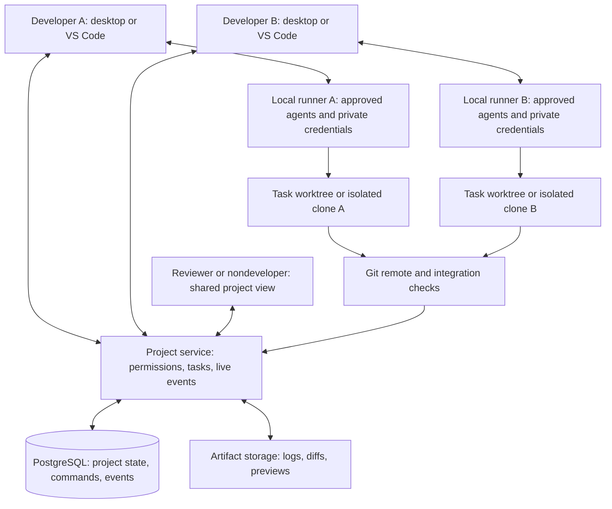

# Tributary: developers and their agents working together

Research and source inspection: 2 November 2026. **Status: architecture and delivery plan. An initial SQLite-backed shared-room service with task ownership, authenticated live updates, and browser/desktop/extension clients is now implemented; see [PROJECT_ROOMS.md](PROJECT_ROOMS.md) for its scope and validation.** The broader PostgreSQL service, remote execution, automatic code synchronization, integration queue and multiplayer editor below remain proposed. Multi-client behavior has been tested locally; two physical computers and public deployment have not been validated.

## Recommended product

Create a shared project room where several people bring their own installed agents. Everyone can see task ownership, progress, proposed changes, test results, and approved project decisions. Each person controls which tasks their machine accepts and which capabilities it exposes. Parallel coding tasks run in separate worktrees or clones. People can deliberately enter a shared editing session when they want to pair on one file.

Example: Ayush assigns the API task to his Codex agent. A teammate assigns the interface task to their Claude Code agent. Another teammate reviews the combined change with their preferred agent. All three see progress and previews in the same room; their credentials and unshared conversations remain local. The API contract is agreed before the two builds run independently. A later integration check tests the combined result.

This is possible, but live text synchronization, agent coordination, and integration correctness require different mechanisms. A CRDT can converge text without making the resulting program correct. A fast socket cannot prevent duplicate agent runs or incompatible API changes. The recommendations below are engineering choices for Tributary, informed by the linked sources; they are not performance results from those products.

## What exists in the current source

| Existing foundation | Verified behavior | Remaining work |
| --- | --- | --- |
| `core/hub.js` | An in-process EventEmitter owns projects, conversations, agent sessions, and running turns | Authenticated identities, remote transport, durable commands and shared project IDs |
| `core/teams.js` | Planner/builder/reviewer recipes and a council run ordinary turns sequentially in a local conversation | Tasks, dependencies, individual developer ownership, machine routing and recovery across hosts |
| `core/race.js` | Parallel candidates run in separate Git worktrees; one candidate's diff can be applied | Complementary task integration, persistent task branches, shared review and a merge queue |
| `core/store.js` | Debounced atomic replacement of one local JSON file | Transactional multi-user state and replayable events; atomic rename is not multi-writer coordination |
| `core/hub.js`, `writeFile` | Local editor saves compare an expected file modification time | Content revisions, atomic update authority and collaboration-aware saves; timestamp checks are not a distributed compare-and-swap |
| `desktop/main.js` | Agent stream updates are coalesced over 80 ms and forwarded to the renderer | Bounded deltas, sequence/offset recovery and subscriber isolation |
| `vscode/extension.js`, `vscode/bridge.js` | The shared app UI calls a local extension host over a message bridge | A collaboration client behind the host; the existing IPC API is not a public server API |
| `ui/src/components/workspace-panel.tsx` | Files tree, file tabs, CodeMirror editor, file previews, project preview and per-turn changes | Shared authorship, remote revision status, presence and explicit branch/workspace identity |
| `core/memory.js`, `core/handoff.js` | Local project facts, work log and bounded context handoffs | Shared versus private memory, authorship, evidence, revision and stale-context handling |

Two current details need fixing before adding remote execution: `Hub.send()` checks its running map before awaited setup and reserves the turn later, so simultaneous requests need an atomic early reservation; the reservation is also per conversation, while separate conversations can write the same project folder. Fix both with explicit workspace ownership. Worktrees separate working files but share repository metadata and do not sandbox processes, secrets, extra folders, network access, or external side effects. Reuse the race idea, not its temporary candidate lifecycle as the entire distributed task system. [Git worktree reference](https://git-scm.com/docs/git-worktree).

## Three collaboration modes

| Mode | User experience | Code authority | Priority |
| --- | --- | --- | --- |
| Shared project | Live tasks, agent status, decisions, diffs, tests and comments; each person codes independently | Task branch/worktree, reviewed integration | First release |
| Pair session | Follow a teammate, edit the same file, share a selected terminal or preview | One designated session workspace and collaborative buffer service | After the shared-project foundation |
| Hosted workspace | An always-on remote environment continues after laptops disconnect | Isolated hosted runner with explicit project credentials | Optional later release |

The first mode delivers multi-developer coordination without requiring every filesystem change to appear in every working directory. Show a teammate's unmerged changes as a live proposed diff. Never silently transplant them into another person's current branch. A shared editing room is scoped to a particular workspace and document generation, not merely a repository path.

## Browser folder view and previews

The requested “all files in a folder” view needs a filesystem abstraction rather than a Git-only file list. The existing `core/git.js`, `listFiles()` serves tracked and untracked nonignored files with a 20,000-entry cap; its non-Git fallback skips hidden files and common generated directories and stops after a bounded depth. It is useful for agent mentions, but it cannot truthfully represent every accessible directory entry. Empty folders also disappear when a tree is reconstructed only from file paths.

Add a separate directory browser that lists immediate children on expansion, with pagination, directory entries, permission errors and a visible continuation state. Fetch content only for selected files. Provide independent “Show hidden files” and “Show ignored files” controls locally; neither control changes what is shared with a team. Preserve the fast filtered file search for mentions. Large/generated directories should open on demand rather than trigger a whole-repository scan at startup.

| Surface | How files become available | Execution boundary |
| --- | --- | --- |
| Desktop app | A selected local folder, read through a validated backend filesystem adapter | Agents run in the approved local runner |
| VS Code extension | Workspace URIs and `vscode.workspace.fs`; native editor commands where appropriate | Local/remote extension host capability determines whether processes can run |
| Browser with local folder | Explicit directory selection where File System Access is supported; import/read-only fallback elsewhere | A browser tab cannot launch installed coding CLIs; connect an approved runner for execution |
| Browser with a shared workspace | Authenticated directory/content service scoped to a selected workspace and revision | Remote or local runner publishes only the granted workspace |
| Browser with a Git snapshot | Files fetched by immutable commit/content identity | Reading a repository snapshot does not imply a writable runtime exists |

Use opaque project/workspace IDs and relative resource identifiers. An entry carries type, name, size, content revision, effective capabilities and sharing status. Resolve roots and symlinks on the host, enforce path bounds, and distinguish unavailable, denied, unsupported and empty states. For remote sources, use URIs rather than assuming all paths are local filesystem strings. VS Code explicitly recommends `workspace.fs` and checking URI schemes for virtual workspaces. Our current Node-based extension is not automatically a browser-only extension. [VS Code virtual workspaces](https://code.visualstudio.com/api/extension-guides/virtual-workspaces).

In compatible browsers, File System Access requires deliberate file/folder permission; a cached handle may require renewed permission. Feature-detect it and retain a folder import fallback without promising in-place save support there. Selecting a local folder must not automatically upload it to the collaboration service. [Chrome's File System Access guide](https://developer.chrome.com/docs/capabilities/web-apis/file-system-access).

Proposed preview capabilities:

| File type | Viewer and behavior |
| --- | --- |
| Source code, text, JSON, YAML | Text editor with syntax highlighting, revision-aware save and useful parse errors |
| Markdown | Editor/preview split with linked local assets resolved through the same permitted content service |
| Images and SVG | Image viewer with dimensions and zoom; isolate SVG rather than injecting arbitrary markup into the app |
| HTML/CSS | Restricted static preview with permitted relative assets; a single HTML blob does not provide full folder-relative site behavior |
| Running web application | Explicit start command on a selected runner, build/server status and an authenticated preview URL |
| PDF | Dedicated bounded viewer, loaded on demand; no claim that this capability exists in today's file panel |
| CSV | Paginated table preview with delimiter/encoding handling and row limits |
| Audio/video | Native media viewer with size/range handling and content-type checks |
| DOCX/XLSX and other complex formats | Separate parser/conversion capability with extraction status and explicit unsupported cases |
| Unknown or oversized binary | Metadata, download/open-externally option and an explanation rather than an empty editor |

Serve untrusted HTML/app previews on a separate origin, without the application's privileged bridge or session cookies. Use iframe restrictions appropriate to static versus interactive content. Do not relax the main application's content policy to make a preview work. The HTML standard explains why sandboxing must be complemented by separate-origin serving. [HTML iframe sandbox](https://html.spec.whatwg.org/multipage/iframe-embed-object.html).

Shared previews need access checks on assets, navigation and WebSocket/HMR upgrades, not just an initial page load. Start with saved build artifacts for reviewers; add runner tunnels for live apps later. Separate unguessable routing from real authorization, and make revocation close an existing session. Codespaces' distinction between private, organization and public ports is useful product precedent, but its plan restrictions and tunnel infrastructure are not capabilities Tributary already has. [Codespaces port sharing](https://docs.github.com/en/codespaces/developing-in-a-codespace/forwarding-ports-in-your-codespace).

## Server and local runner

Start with one self-hostable Node/TypeScript service and PostgreSQL, plus a local runner in each desktop app or extension host. Use an authenticated WebSocket transport for live events and HTTP for commands, paginated snapshots and artifacts. Socket.IO is a reasonable initial transport candidate because it provides reconnect support, but its default delivery is at-most-once; implement persistence and replay in the application. No cross-client ordering or durable delivery should be inferred from an open connection. [Socket.IO delivery guarantees](https://socket.io/docs/v4/delivery-guarantees/).

Keep shell execution and inference out of the coordination service. Local runners initiate outbound connections; developers should not need inbound ports on their laptops. The runner maps a server-side project ID to a locally approved repository root, advertises installed capabilities, and accepts only explicitly permitted task classes. The server must not supply arbitrary local paths or turn a shared comment into a shell request.

Use these durable records initially: organizations, memberships, projects, repository bindings, devices, capability grants, tasks, dependency edges, task attempts, run events, decisions, artifacts, review records and integration attempts. Private local conversations remain outside these shared records unless their owner shares them. Git remotes distribute committed code; the server stores coordination metadata and selected artifacts. A room's access controls also govern code excerpts and logs.

For a small deployment, PostgreSQL can provide transactional task claims and the event log. Add object storage for large artifacts when needed. Redis can later support ephemeral fan-out and presence; it need not be a prerequisite. A database notification can wake an event dispatcher, but replay reads the durable event table. PostgreSQL delivers notifications after commit; notifications are not the retained history. [PostgreSQL NOTIFY](https://www.postgresql.org/docs/current/sql-notify.html).

## How developers and agents coordinate

1. A person or a planner proposes a task graph: objective, acceptance checks, dependencies, interface contracts, expected files and owner. A person chooses or approves the assignment policy.
2. A developer accepts a task for one of their allowed agents. The server atomically claims a runnable task, allocates an attempt and lease epoch, and records the command and event in one transaction. A competing claimant receives the existing ownership state.
3. The runner acknowledges the attempt, prepares a branch from a recorded base commit, and checks local capacity. Working copies on different computers are independent clones; linked worktrees are a local optimization inside each clone.
4. The runner starts the agent once for that accepted attempt and publishes structured progress, changed paths, test results and a bounded handoff summary. Dependencies wake on accepted results, not on every token.
5. A result includes its base and result commits, diff artifact, actual test commands and outcomes, unresolved issues, and evidence references. The UI distinguishes reported progress from locally verified tests and accepted integration.
6. Review and integration happen against the current target branch. If it advanced, rebuild the integration candidate and rerun the required combined checks. Keep the original branch and evidence if conflicts require human or agent assistance.

Task states should distinguish `ready`, `claimed`, `running`, `blocked`, `review`, `integration`, `done`, `failed`, `cancel_requested` and `canceled`. Dependency cycles are rejected. Completion is a validated state transition, not a word detected in an agent's text. A review agent can advise; project policy determines who can approve and merge.

Use short database transactions for claims, not a lock held during an agent run. `FOR UPDATE SKIP LOCKED` is appropriate for queue consumers, not a general consistency strategy. Bound each runner's slots and retain task priority and fairness between projects. [PostgreSQL SELECT locking](https://www.postgresql.org/docs/current/sql-select.html).

### Leases, crashes and duplicate work

Heartbeats renew a task lease, with server time and an increasing ownership epoch. Every accepted result, status change and integration request checks the current attempt, epoch, expiry and authorization in a transaction. A lost lease marks the attempt uncertain; it does not prove that its process stopped. Quarantine its branch, request local termination, and reconcile the runner journal before a retry is allowed to create external effects.

Fencing tokens help only where the receiving write authority checks them. Ordinary coding CLIs can write their filesystem and call external services without consulting the coordinator. Therefore fencing protects server acceptance and integration, while process isolation, scoped credentials, branch permissions and explicit retry policies protect execution. Do not claim exactly-once agent execution. The stale-holder problem and resource-side enforcement are explained by [Martin Kleppmann](https://martin.kleppmann.com/2016/02/08/how-to-do-distributed-locking.html).

Give every user command a stable client-generated ID and payload hash, scoped to its actor and project. Repeating an identical command returns the recorded result; reusing the ID with different content is rejected. Persist local accepted/started/finished attempt transitions before acknowledging them. A crash between process launch and recording its identity must surface as an uncertain attempt, not trigger an automatic second launch. External tools need their own idempotency or reconciliation because deduplicating server messages cannot undo a repeated payment, push or deployment. [Temporal's idempotency explanation](https://temporal.io/blog/idempotency-and-durable-execution).

Path overlap is an advisory warning: two tasks can be semantically incompatible while editing different files. Shared interface contracts and integration tests address that. For dependency files, migrations and generated outputs, explicit task dependencies are usually clearer than a global repository lock. A small serial integration queue is a correctness boundary; compare its wait time with useful throughput before automating more elaborate scheduling. GitHub documents checks against the latest target and preceding queued changes; product availability varies by repository and plan, so keep Tributary's interface independent of GitHub-only features. [GitHub merge queue](https://docs.github.com/en/repositories/configuring-branches-and-merges-in-your-repository/configuring-pull-request-merges/managing-a-merge-queue).

## Live updates and reconnects

Separate streams by purpose:

| Information | Delivery and storage rule |
| --- | --- |
| Task claims, permissions, accepted results, integration decisions | Durable transaction and replayable event; acknowledge after commit |
| Shared agent output | Ordered bounded deltas per run with offsets; persist accepted chunks; fetch full output on demand |
| Cursor, selection, online state and typing | Ephemeral, rate-limited and expiring; replace old presence rather than replaying it |
| File contents in a pair session | CRDT protocol with document-specific state vectors and persisted updates |
| Diff, image, build log or exported document | Content-addressed artifact or versioned resource, fetched on demand |

Use a versioned envelope with `projectId`, `eventId`, `actorId`, `entityId`, `entityRevision`, `commandId`, `kind` and a bounded payload. Shared project events have a monotonically increasing project cursor. Allocate that cursor in the same transaction as the state update and event insert, using a locked project counter so replay order follows committed state. An ordinary database sequence allocated before commit can be observed out of order and is insufficient for a naive resume cursor. Split very busy projects into explicit streams only when profiling justifies it.

Bootstrap with a consistent snapshot and its cutoff cursor, then subscribe/replay events after that cutoff. On reconnect, reauthorize and resume from the last applied cursor; if retention expired, fetch a new snapshot and reconcile pending commands by their IDs. Store the applied cursor together with cached state. Private streams use separate authorization and cursors. Disconnection recovery can fail even with Socket.IO, so application resynchronization remains necessary. [Socket.IO recovery limits](https://socket.io/docs/v4/connection-state-recovery/).

Start with 40–80 ms text batching, immediate final/error notifications, and presence capped at about 10 updates per second; treat these as tunable design defaults. Delta output must carry run ID and offset, with missing ranges recoverable. Coalesce presence for slow consumers, but never silently drop terminal run state. Cap outbound queues and disconnect an overloaded subscriber into a recoverable state rather than letting it consume unlimited memory. Subscribe to the open project and visible runs, not every organization's token stream. A project card can receive status summaries while its logs remain unloaded.

## Same-file editing and filesystem changes

For intentional pair sessions, evaluate Yjs with the CodeMirror 6 binding and an authenticated Hocuspocus document server. Validate the exact compatible package versions before adoption. Yjs updates support idempotent, order-independent application and differential synchronization; awareness is a separate, ephemeral channel. These properties concern document convergence, not application correctness or access control. [Yjs document updates](https://docs.yjs.dev/api/document-updates), [Yjs awareness](https://docs.yjs.dev/getting-started/adding-awareness).

Bind a document to `(project, workspace, branch generation, file identity)`; two unrelated branches must not accidentally join the same room. File rename/delete operations are authoritative metadata changes, not just text edits. Undo should normally affect the user's own edits. Restore and version history must preserve other people's work and make any replacement explicit.

One session service owns the mapping between collaborative buffers and files on disk. Editor edits enter its transaction stream. Agent edits arrive as revision-based patches; if the base is stale, preserve the proposal and rebase or request review. A CLI that edits disk directly must run in its own task workspace or a deliberately restricted single-writer pair workspace until its writes can be mediated. Watching a file and inserting a replacement after the fact cannot prevent an earlier overwrite.

Use filesystem watchers as hints: coalesce path changes, ignore build directories, compare content hashes, and rescan after overflow, rename ambiguity or reconnect. Own writes need origin tracking to prevent echo loops. A branch change creates a new generation and invalidates open revisions and indexes. External editor or agent changes should show a diff or reload clean buffers; keep dirty drafts until the person resolves the conflict.

Do not enable the existing whole-file save endpoint against a collaborative buffer. Hocuspocus offers authentication and read-only hooks, but Tributary still needs project authorization, revocation handling and bounded updates. Its Redis extension distributes updates between instances and explicitly does not persist them; adding more instances with broadcast replication does not necessarily reduce document CPU load. [Authentication hooks](https://tiptap.dev/docs/hocuspocus/server/hooks), [Redis extension limits](https://tiptap.dev/docs/hocuspocus/server/extensions/redis).

## Shared memory and agent context

Keep private notes, task notes, proposed decisions and approved project decisions distinct. A shared decision records author, scope, revision, evidence, relevant commit or artifact, approval state and superseding decision. An agent's suggestion does not automatically become a trusted project rule. Existing AGENTS.md remains a repository instruction source; maintain approved shared decisions through a reviewed versioned projection rather than concurrent blind appends.

At task start, retrieve only the approved decisions, interface contracts, dependency outputs and relevant code for the recorded base revision. Mark context invalidated when a dependency or decision changes. Let the runner finish its isolated proposal or explicitly restart/rebase; do not mutate the agent's working files under it. Publish a compact handoff at meaningful milestones, with links to complete evidence. Retrieve only content that the receiving person and runner can access. Avoid copying every private conversation or every streamed token into every agent's context.

This follows the local ownership goal described by [Ink & Switch](https://www.inkandswitch.com/essay/local-first/) while retaining an authoritative shared service for task claims and integration. Offline users can keep local work and draft assignments; the UI must say when a claim or shared decision is still pending server acceptance.

## What the interface should add

Keep the requested VS Code-style explorer, file tabs, editor and previews, plus the simpler everyday-task home. Add:

- **People and agents:** developer identity, selected agent, assigned task, machine availability and current branch. Online status alone does not mean an agent is runnable.
- **Project task board:** dependencies, clear owners, acceptance checks, blockers, review status and a visible “waiting for dependency” explanation.
- **Live changes:** a teammate's proposed diff, authorship, base revision, overlap warnings, tests and a follow action; show unmerged and integrated states distinctly.
- **Pair session:** invite a teammate, choose edit/view access, share a selected file, follow a cursor, and end the session. Invite acceptance never grants shell execution by itself.
- **Previews:** identify the owner, branch, build and access policy. Publish a built artifact or use an explicitly approved authenticated tunnel; another user's localhost URL is not automatically accessible.
- **Shared decisions:** searchable approved facts with source links, history, proposed changes and an explanation of what each agent received.
- **Settings:** searchable local/user/project/team settings with visible effective values and policy overrides. Separate collaboration membership, machine execution grants, shared previews and spending limits from visual preferences.
- **Nondeveloper participation:** comment on tasks, read results, open shared documents/previews and approve requested product decisions without exposing agent internals by default.

## Access and execution boundaries

Use separate capabilities for reading shared code, editing collaborative files, assigning tasks, accepting runs on a device, controlling terminals, opening previews and merging results. A project invitation does not confer every capability. Recheck membership for subscriptions and commands; revocation ends affected subscriptions and runner grants, while reporting whether an already started process actually stopped.

Keep personal model credentials and sign-ins local. Share a runner capability, not its credential; the device owner approves its limits and every accepted task has an attributable requester. Provider terms and account capabilities must be checked for each supported adapter before promising team-wide use of personal subscriptions. Hosted runners use separately authorized project service credentials. Default shared logs to structured summaries because arbitrary CLI output can contain secrets; masking alone cannot guarantee safe publication.

File allowlists, symlink containment and environment boundaries apply in addition to Git ignores. Git worktrees provide change isolation, not a security sandbox. Remote task code and tests need restricted processes or containers, scoped network access and explicit credentials. Start terminal sharing in view-only mode. Live Share's design separates read-only access, file exclusions and terminal/server sharing, illustrating why these permissions should be explicit. [Live Share security](https://learn.microsoft.com/en-us/visualstudio/liveshare/reference/security).

TLS protects transit. The proposed authoritative server can read shared metadata, logs and collaborative documents; this proposal is not end-to-end encryption. End-to-end encryption would be a separate design affecting server-side validation, search, recovery and hosted runners. The server should never expose the Electron or VS Code host's entire existing method allowlist as remote RPC.

## Speed, native code and deployment choices

| Choice | Recommendation and tradeoff |
| --- | --- |
| Initial server | Node/TypeScript + PostgreSQL; reuse validated agent contracts, keep heavy jobs in runners and workers, and keep the gateway responsive |
| Hosting | One regional service close to the initial team; start with a controlled small deployment and measure, with backups and a tested restore path |
| Project sharding | Route a project/document to one current owner when scale warrants it; move ownership with recorded epochs and reconnect recovery |
| Cloudflare Durable Objects | Alternative managed room ownership and WebSocket hibernation; useful for coordination, but agent execution still needs separate runners and deployment/persistence boundaries change |
| Rust | Candidate for profiled indexing, hashing, diffing or large document serialization; use a worker/sidecar or asynchronous native boundary, with an equivalent fallback |
| Hosted runners | Separate optional execution tier; requires sandboxing, credentials, capacity/cost limits and lifecycle management |

Cloudflare documents per-object coordination and sockets that can survive hibernation; in-memory state must be reconstructed on wake. This is a deployment alternative, not a reason to combine it with PostgreSQL, Redis, Temporal and Kubernetes in the first release. [Durable Object WebSockets](https://developers.cloudflare.com/durable-objects/best-practices/websockets/).

Figma's 2018 case is particularly relevant to the earlier low-level language question: it moved performance-sensitive multiplayer work into Rust child processes while retaining the host system. The lesson for Tributary is measured isolation of expensive work, not an assumed gain from rewriting the entire app. The workloads and reported gains in that article are Figma's, not ours. [Rust in production at Figma](https://www.figma.com/blog/rust-in-production-at-figma/).

No internet service can promise zero latency or universal uptime. Local typing and previews should avoid server round trips; coordination should degrade into a clearly labeled disconnected state. Do not keep a dead server on the startup critical path. Show cached project state, start the local workspace, and reconnect in the background.

### Proposed acceptance targets, not measured results

For the initial test envelope of 10 active developers, up to 20 active agent runs, a 10,000-file repository, bounded individual text documents, and a measured client-to-service RTT of at most 80 ms:

| Measurement | Initial target |
| --- | --- |
| Ordinary local typing to paint | p95 below 50 ms under representative streaming load |
| Accepted task/presence update visible to another connected peer | p95 below 250 ms, measured separately from durable acknowledgement |
| Ordinary local-file preview after relevant change | p95 below 500 ms; application builds measured separately |
| Short-disconnect replay | Consistent state within 3 seconds after transport is restored for the defined replay-size case |
| Final task result | Every acknowledged result survives coordinator process restart and replay |
| Slow peer | Queue remains within configured byte/event limits and other peers remain responsive |
| UI startup | Collaboration unavailable does not block local first paint or access to local work |

Record hardware, network impairment, repository size, output rates, payload bounds, sample count, event-loop delay, memory, transferred bytes and p50/p95/p99. Set actual message/document size limits from the prototype and enforce them at client and server; giant files need a fallback read-only or separate workflow. Benchmark useful accepted changes per hour and cost per accepted task against a single-agent baseline. More concurrent agents can increase conflicts and spend while reducing useful throughput.

## Stronger evidence for the team design

The public examples disagree on how much hierarchy is useful. Cursor's January 2026 experiment reports that flat coordination stalled and that planner/worker separation improved progress. Anthropic's February 2026 compiler experiment describes isolated agent clones, task claiming and no orchestration agent; its biggest gains depended on a verifier that exposed independent problems. These are different workloads and harnesses, not proof that one coordination pattern always wins. Tributary should enforce ownership, evidence and recovery in software while making planner/reviewer roles optional. [Cursor experiment](https://cursor.com/blog/scaling-agents), [Anthropic compiler experiment](https://www.anthropic.com/research/building-c-compiler).

The compiler article also describes agents colliding on a single shared blocker until the test strategy made independent progress possible. Consequently, splitting work into “frontend agent” and “backend agent” is insufficient when both are still guessing the API contract. Attach a versioned contract to the dependency edge and verify the consumer against the producer's accepted artifact.

For a counterweight to success stories, CooperBench evaluates collaborating coding agents on feature pairs with possible conflicts. Its paper reports weaker cooperative outcomes than a solo baseline; adding natural-language communication reduced merge conflicts without a statistically significant improvement in overall success in its evaluated setup. That supports testing final behavior rather than counting messages or clean merges. It does not prove future agents, all human-led teams or Tributary's proposed harness will have the same result. Prefer the paper's versioned methods and tables over mixing numbers from differently worded blog summaries. [CooperBench paper](https://arxiv.org/html/2601.13295v1).

Replit's historical engineering account is important for the requested web folder view: collaboration was integrated into the file-change protocol rather than confined to the editor UI. The implication for our design is that external tool writes, rename/delete and terminal changes must pass through or be reconciled with the workspace authority. Choosing Yjs for text while leaving independent whole-file writes untouched is incomplete. Replit used OT; that is evidence about integration scope, not a requirement to use its algorithm. [Replit: collaborative at heart](https://replit.com/blog/collab).

Cursor's September 2026 self-hosted-machines design illustrates an outbound worker connection and dedicated execution environments. Its documented model retains planning/inference in Cursor's cloud. Tributary's recommended model keeps the user's chosen local agent loop local, so do not equate local tool execution with all processing remaining private. [Cursor self-hosted machines](https://cursor.com/blog/self-hosted-machines).

Anthropic's October 2026 source-control article describes sparse/on-demand working copies, incremental changes and server APIs at an unusually large internal scale. For Tributary, borrow demand loading, bounded caches and incremental operations. Retain Git compatibility; rebuilding source control would be a separate product and is unjustified by our current evidence. [Anthropic source-control engineering](https://www.anthropic.com/research/redesigning-source-control).

### Make requests and commitments checkable

Agent coordination should expose small structured actions: propose or claim a task, publish an interface version, request a decision, report a blocker, attach a tested result, and acknowledge a dependency update. Each request has a recipient, relevant revision, state and evidence link. Only genuine dependency requests block work; ordinary status messages do not create approval gates. Escalate an unresolved blocking decision to its human owner instead of letting agents repeatedly ask each other indefinitely.

Do not require a model for scheduling, lease renewal, permission checks or deduplication. Let models propose decomposition and explain conflicts; deterministic services enforce the accepted state machine. Free-form agent chat can supplement this record, but it must not be the only source of ownership or completion truth.

### Compare coordination policies before choosing a default

Run the same representative change set under: (A) one agent performing all work, (B) two isolated agents with deterministic task ownership, (C) a planner plus independent workers, and (D) the best of those with a separate review pass. Use the same models, starting revisions, acceptance tests and total resource caps where possible; report extra planner/reviewer cost explicitly. Include tightly coupled API changes, independent fixes, migrations and human-directed handoffs, not only easy parallel tasks.

Measure accepted integrated changes, hidden-test success, wall time, human intervention, duplicate work, merge repair, stale assumptions and total model/tool cost. Repeat trials because model behavior varies. Require the useful throughput or quality improvement to survive the added cost and coordination delay. These are proposed experiments; none has been run for the shared-server architecture yet.

## Delivery plan tied to the existing files

| Stage | Concrete scope | Acceptance gate |
| --- | --- | --- |
| 0. Local correctness | Atomic early reservations in `core/hub.js`; task/workspace identity; bounded event envelopes; retain current team/race behavior | Two simultaneous starts cannot create two executions for one reserved attempt; separate writers cannot silently share a task workspace |
| 1. Shared project room | New `server/` permission, task, event and snapshot modules; new `core/collaboration/` client and local runner journal; device/project bindings | Two real computers and two identities see authorized tasks and selected progress; reconnect and server restart preserve state |
| 2. Parallel owned tasks | Durable dependency graph, fenced task attempts, task worktree lifecycle based on `core/race.js`, validated result artifacts | Two developers' different agents complete complementary tasks; expired attempts cannot publish accepted results; uncertain attempts are surfaced |
| 3. Review and integration | Existing changes/review UI extended with authorship, PR adapter or independent integration queue, combined checks | Concurrent changes to a shared interface cannot be marked done until the exact integration candidate passes policy |
| 4. Pair editing and preview sharing | CodeMirror/Yjs spike; authenticated document ownership; disk bridge; opt-in terminal and preview sharing | Concurrent inserts, rename/delete, offline edits, dirty buffers, branch changes and permission revocation behave correctly |
| 5. Scale and optional hosting | Project/document sharding, capacity controls, hosted runner option, measured native hotspots | Published load/failure results and restored backups meet the agreed envelope before wider rollout |

Stage 1 should initially be observer-first: people share tasks and status, and accept runs locally. Enable remote assignment only after device grants and duplicate-start recovery pass their checks. Preserve desktop and extension host parity through a narrow shared collaboration API. The existing task-first, file editor, settings and preview work remains useful independently of the server.

Do not give a calendar estimate before the two-host spike establishes the authentication, runner-lifecycle and editor-integration costs. Stage 1 is the smallest valuable collaboration release; same-file multiplayer and always-on cloud agents are separate additions.

## Required failure tests

- Two claims arrive simultaneously; one wins, with a consistent recorded loser response.
- A client retries the same command after losing its response; one accepted attempt is returned.
- A runner disconnects during a paid model request or after a Git push; the run becomes uncertain and is reconciled without blind replay.
- A stale runner renews or submits after reassignment; the server rejects its epoch and keeps its branch available for inspection.
- An integration check passes, then the target branch changes; the stale check cannot authorize a different merge result.
- Cursor floods, agent output floods and a very slow subscriber do not delay other projects' final events.
- Server restart between database commit and broadcast is recovered from the event table; snapshot/subscription races lose no accepted updates.
- A revoked or cross-project identity cannot subscribe, fetch artifacts, join a document room or control a runner using a guessed ID.
- Concurrent same-file changes converge as text, while invalid combined code still fails its independent checks.
- External disk edits, file renames, watcher overflow and branch switches preserve dirty drafts and invalidate stale revisions.
- A stopped or sleeping laptop cannot be presented as an always-on runner; cancellation is shown as requested until its actual outcome is known.
- Unshared credentials, local paths and private context stay out of server snapshots and shared exports; test arbitrary logs as untrusted content.

## Engineering reading list and evidence boundaries

This is a selected primary-source reading list, not an exhaustive inventory of engineering blogs. Historical articles explain decisions at publication time; library and service adoption still requires current version, license, packaging and capability checks. Sources were read through web search/page retrieval. Agent Reach's Exa endpoint and update check failed DNS in this environment, so built-in web search supplied the evidence instead. No authenticated social-platform research was required.

| Source | What it contributes | Limit on the inference |
| --- | --- | --- |
| [Figma: how multiplayer works, 2019](https://www.figma.com/blog/how-figmas-multiplayer-technology-works/) | Authoritative server, optimistic local updates and data-specific synchronization tradeoffs | Figma's object-property model is not a text CRDT to copy into a code editor |
| [Figma: making multiplayer more reliable, 2022](https://www.figma.com/blog/making-multiplayer-more-reliable/) | Journal, sequence numbers and snapshots for recovery | Its reported save latency is not a Tributary target achieved here |
| [Figma: Rust in production, 2018](https://www.figma.com/blog/rust-in-production-at-figma/) | Isolating expensive synchronization/serialization work behind a native process boundary | Different workload and historical runtime; measure Tributary before choosing a rewrite |
| [Zed: CRDTs and multiplayer text, 2022](https://zed.dev/blog/crdts) | Stable text identities, asynchronous edits and undo semantics | Text convergence alone does not coordinate coding agents |
| [Zed: channels for collaboration, 2024](https://zed.dev/blog/channels) | Persistent team rooms, shared projects, notes and presence | Product description, not a controlled performance benchmark |
| [Linear: scaling the sync engine, 2023](https://linear.app/now/scaling-the-linear-sync-engine) | Primary team's talk about evolving its real-time application and API | Linked talk overview was read; the video was not transcribed or independently benchmarked |
| [Cursor: scaling long-running coding, 2026](https://cursor.com/blog/scaling-agents) | Reports lock contention, ownership problems and a planner/worker approach | Experimental vendor report; its own system found an integrator role could become a bottleneck, so test coordination costs rather than copying every role |
| [Anthropic: multi-agent research system, 2025](https://www.anthropic.com/research/multi-agent-research-system) | Task decomposition, context separation, operational recovery and cost concerns | Research results do not establish equivalent coding gains; the article explicitly discusses coding's tighter dependencies |
| [Ink & Switch: local-first software, 2019](https://www.inkandswitch.com/essay/local-first/) | Responsive local work, offline continuity and user ownership | Architectural ideals, not proof of our proposed access or task semantics |
| [Microsoft: Live Share FAQ](https://learn.microsoft.com/en-us/visualstudio/liveshare/faq) | Sharing editor context, debugging, terminals and applications | A host-backed pair session differs from independent parallel task branches |
| [Microsoft: Live Share security](https://learn.microsoft.com/en-us/visualstudio/liveshare/reference/security) | Access boundaries, explicit sharing and direct/relay connectivity | Its encryption guarantees do not transfer to our proposed server |
| [Yjs: document updates](https://docs.yjs.dev/api/document-updates) | Differential update synchronization and idempotent application | The transport and durable storage must still be supplied |
| [Yjs: awareness](https://docs.yjs.dev/getting-started/adding-awareness) | Presence kept outside durable document content | Presence is not task ownership or an execution lease |
| [Hocuspocus: server hooks](https://tiptap.dev/docs/hocuspocus/server/hooks) | Authenticated document entry and read-only sessions | Project authorization and revocation remain application responsibilities |
| [Hocuspocus: Redis extension](https://tiptap.dev/docs/hocuspocus/server/extensions/redis) | Cross-instance sync and its persistence/CPU caveats | Replicated fan-out is not automatic workload sharding |
| [Socket.IO: delivery guarantees](https://socket.io/docs/v4/delivery-guarantees/) and [recovery](https://socket.io/docs/v4/connection-state-recovery/) | Ordering, arrival guarantees and reconnect failure handling | A library reconnect does not provide exactly-once execution |
| [PostgreSQL: SELECT locking](https://www.postgresql.org/docs/current/sql-select.html) and [NOTIFY](https://www.postgresql.org/docs/current/sql-notify.html) | Queue claims, short transactions and post-commit wakeups | Notifications do not replace durable replayable event rows |
| [Temporal: idempotency](https://temporal.io/blog/idempotency-and-durable-execution) | Stable request identities and side-effect deduplication | A workflow engine cannot make an arbitrary external command idempotent |
| [Kleppmann: distributed locking, 2016](https://martin.kleppmann.com/2016/02/08/how-to-do-distributed-locking.html) | Paused clients, lease expiry and receiver-enforced fencing | Unmediated agent filesystem writes cannot be fenced by a server-side number |
| [Git: worktree reference](https://git-scm.com/docs/git-worktree) | Independent working trees and shared repository metadata | Worktrees are neither independent machines nor process sandboxes |
| [GitHub: managing a merge queue](https://docs.github.com/en/repositories/configuring-branches-and-merges-in-your-repository/configuring-pull-request-merges/managing-a-merge-queue) | Testing integration against the current target and queued predecessors | Feature availability and configured checks matter; tests cannot guarantee semantic correctness |
| [Cloudflare: Durable Object WebSockets](https://developers.cloudflare.com/durable-objects/best-practices/websockets/) | Stateful room coordination, hibernation and batching | An alternative deployment model that still requires durable application semantics |
| [Replit: collaborative at heart, 2019](https://replit.com/blog/collab) | Integration of real-time and asynchronous collaboration throughout file changes | Historical OT system; do not transplant its protocol without our own design |
| [Anthropic: parallel compiler agents, February 2026](https://www.anthropic.com/research/building-c-compiler) | Independent clones, task claiming and verifiers that enable parallel work | Costly capability experiment with stated limitations, not a general production guarantee |
| [CooperBench, versioned paper](https://arxiv.org/html/2601.13295v1) | Controlled counterevidence for assuming peers and messaging improve coding outcomes | Evaluated models and task distribution differ from human-led Tributary use |
| [Cursor: self-hosted machines, September 2026](https://cursor.com/blog/self-hosted-machines) | Outbound workers and an execution/control separation | Its cloud agent loop differs from our local-agent recommendation |
| [Anthropic: source control, October 2026](https://www.anthropic.com/research/redesigning-source-control) | Incremental changes and on-demand source access at scale | Its unusual internal scale does not justify a new version-control system here |
| [VS Code: virtual workspaces](https://code.visualstudio.com/api/extension-guides/virtual-workspaces) | Filesystem providers, URI identities and capability declarations | Node extensions and arbitrary local tools cannot simply run in a browser |
| [Chrome: File System Access](https://developer.chrome.com/docs/capabilities/web-apis/file-system-access) | User-selected local directory access and permission renewal | Browser-dependent capability; imports are a different fallback with different save semantics |
| [HTML standard: iframe sandbox](https://html.spec.whatwg.org/multipage/iframe-embed-object.html) | Separate-origin isolation of embedded untrusted content | A preview still needs content policy, access checks and safe host integration |
| [GitHub: Codespaces port forwarding](https://docs.github.com/en/codespaces/developing-in-a-codespace/forwarding-ports-in-your-codespace) | Private, organization and public preview-sharing modes | Service capabilities and plan limits do not transfer to Tributary |
| [VS Code: user/workspace settings](https://code.visualstudio.com/docs/configure/settings) | Searchable configuration and visible scope precedence | Our proposed team policy layer is an additional design choice |

Related plans: [general-user roadmap](PRODUCT_ROADMAP.md), [startup and native bridge](PERFORMANCE_ARCHITECTURE.md), and [existing multi-agent research](MULTI_AGENT_LANDSCAPE.md). This document uses freshly retrieved primary sources and current inspected code; it does not independently validate every claim in the older landscape report.
