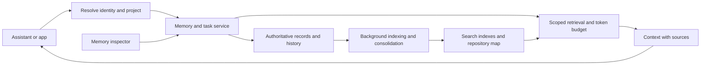

# Tributary improvement plan

Prepared 2 November 2026. Updated after source files became available. Status: source-grounded proposal with synthetic performance measurements; live product validation remains separate.

## Evidence and scope

The folder was empty during the first research pass. Application source subsequently became available and was inspected across the agent runner, desktop bridge, shared memory, persistence, Git checkpoints, handoff, team workflows, and React state. Git metadata is still unavailable here, so this is a working-tree review without a verified revision or diff baseline. Public projects with the same name were not treated as this product.

Verified product scope: Tributary is an Electron/React application that runs local coding-agent CLIs, normalizes their output, and supports session handoff. The core already contains Git checkpoints, plan/build/review recipes, Markdown project memory, a work log, MCP configuration, and skill sharing. These are source capabilities, not proof that every flow is exposed or works in the desktop UI. Several core actions are absent from the desktop API allowlist and need an end-to-end integration inventory before adding overlapping features.

The detailed native-bridge decision, bottleneck evidence, synthetic measurements, and implementation sequence are in [PERFORMANCE_ARCHITECTURE.md](PERFORMANCE_ARCHITECTURE.md). Measurements and their limits are in [performance/BASELINE.json](performance/BASELINE.json).

Completed during this pass: refined vector branding and matching app icons; window creation before agent-version probes finish; early publication of installed agents; shared overlapping scans; and conversation display without waiting for Git status. All 40 tests, the UI build, the type check, and the X11 desktop smoke test passed. The median app-ready-to-window-ready interval decreased from 3.185 seconds to 0.622 seconds in three local warm-cache runs per variant against a reconstructed previous startup gate. See [performance/STARTUP.json](performance/STARTUP.json) for conditions and raw timings; this is not a cross-platform cold-start claim.

## Product direction

The audience and user-facing delivery order are now defined by [PRODUCT_ROADMAP.md](PRODUCT_ROADMAP.md), which expands Tributary into everyday writing, document, study, and knowledge-work workflows. This document supplies the technical foundation for memory, coding continuity, and reliability.

Proposed promise: **Bring your task and materials, get useful help, and continue with your work and context intact.**

Build on the existing desktop orchestrator and agent execution. Add a connection path that does not require a coding CLI, task-oriented workspaces, and editable outputs. Strengthen memory and continuity while retaining developer controls in an optional advanced area. Prioritize a useful general-user workflow before expanding the full feature catalog.

## What the research suggests

| Source | Verified pattern | Proposed application |
| --- | --- | --- |
| [Anthropic: effective context engineering](https://www.anthropic.com/engineering/effective-context-engineering-for-ai-agents) | Context is finite; select useful information and retrieve detail when needed. | Assemble small context packages per task, with evidence links and a hard token limit. |
| [Aider: repository map](https://aider.chat/docs/repomap.html) | Rank repository files and key symbols within an adjustable token budget. | Maintain a compact project map to guide selective file reads. |
| [Letta: memory blocks](https://docs.letta.com/v1-sdk/memory/memory-blocks) | Persistent structured blocks can be shared or read-only; concurrent full replacements require care. | Separate stable rules from working notes, and protect updates with revisions. |
| [Graphiti documentation](https://help.getzep.com/graphiti/getting-started/welcome) and [platform overview](https://www.getzep.com/platform/graphiti/) | Combine semantic, keyword, and graph retrieval; track facts as they change. | Retrieve by meaning and exact identifier; record when memories become outdated. |
| [Mem0: background consolidation](https://mem0.ai/blog/dream-background-memory-consolidation-for-ai-agents) | Background maintenance can merge duplicates, supersede old facts, and preserve history. | Run consolidation off the user-facing request path, with version checks. |
| [MCP architecture](https://modelcontextprotocol.io/docs/learn/architecture) | A shared protocol exposes context and tools to hosts, using local stdio or remote Streamable HTTP. | Build one memory service with tested client adapters. MCP availability alone does not prove client behavior. |

These are design references. Their published performance does not establish Tributary performance. Compatibility with any particular assistant remains a proposed integration until exercised end to end.

## Priority 1: make the first session easy

Proposed journey:

1. Open the app and choose a project folder or a read-only demonstration project.
2. Select an assistant from the integrations actually tested in the release.
3. See a plain-language preview of what will be read, remembered, and sent to external providers.
4. Run a connection check that writes and retrieves a harmless test memory in an isolated scope.
5. Ask a useful starter question, such as “What should I know before editing this project?”
6. Return in a new session and recover the same project context.

Offer a personal setup that avoids manually administering a database. If the existing stack already has a reliable storage backend, package and automate that first. Evaluate embedded storage for a local edition only after measuring maintenance and migration cost. Offer managed hosting later for users who need synchronization and team access.

Acceptance: at least 8 of 10 new users complete setup and the first useful retrieval without assistance in under five minutes on supported systems. Measure installation failures, abandonment, and accessibility issues. Publish a concrete OS/client/language support matrix; expand it based on demand.

## Priority 2: make memory accurate and controllable

### Separate memory by purpose

| Memory type | Example | Lifecycle |
| --- | --- | --- |
| User preference | Preferred explanation style | Explicit user control; private by default |
| Project rule | Test command or architecture constraint | Versioned; linked to source evidence |
| Decision | Why a dependency or design was chosen | Record rationale, alternatives, author, and supersession |
| Working task | Goal, progress, pending checks, next action | Short-lived; checkpointed and resumable |
| Observed outcome | A failed approach or a verified fix | Store conditions and evidence, not an unconditional rule |
| Shared team knowledge | Approved project conventions | Explicit scope and editor permissions |

Keep original events separate from curated memories. Summaries should link back to evidence. A passing check can support a narrow observation; it should not automatically become a permanent instruction.

Minimum record fields: identity, workspace/project scope, memory type, content, source reference, author or originating agent, creation/update times, revision, verification state, validity range, sensitivity, and supersession reference. Attach repository/branch/commit and file or symbol identity where relevant. Treat model confidence as a retrieval signal rather than proof.

### Govern the write path

Capture event → filter secrets and unsupported content → propose a memory → check exact duplicates and related claims → commit with a revision → index asynchronously.

Use idempotency keys for retried events and compare-and-swap revisions for updates. Concurrent incompatible claims should become a visible conflict rather than silently overwrite each other. A transaction can protect storage consistency without deciding which claim is correct.

Background jobs can suggest merges and supersession. Preserve original evidence and make changes reversible within the retention policy. Do not automatically rewrite pinned policies from conversational text. Distinguish retrieved content from instructions, including when a document asks the agent to change its behavior.

### Make memory visible

Provide a searchable inspector with edit, pin, forget, export, and history actions. Each result should explain its source, scope, verification date, and why it was retrieved. Users should be able to correct a fact using ordinary language and see the resulting change.

Personal memory is private by default. Project and team sharing require explicit scopes. Apply access checks to retrieval, exports, caches, background jobs, and derived summaries. Forgetting must propagate to indexes, embeddings, caches, and derived artifacts; document backup retention and deletion limits.

Acceptance: source links on all curated memories; no cross-scope results in isolation tests; deterministic conflict handling; a deleted fact cannot reappear through a cache or an old summary.

## Priority 3: reduce time to a correct coding result

### Retrieve the right context

Resolve authorized scope first. Search exact paths and symbols alongside semantic matches, then rank for task relevance, validity, evidence, and source freshness. Deduplicate candidates before packing context. A recent vague note should not outrank a still-valid explicit project rule.

Return a compact package containing current task state, relevant decisions, constraints, useful file/symbol references, and required checks. Allow detail to be fetched on demand. Make the token budget adjustable, and keep raw tool logs outside the default package.

### Keep code context current

Maintain an incremental file/symbol map using file hashes and language-aware parsing where available. Include uncommitted changes and branch identity. Re-index affected files after edits; revalidate source-dependent memories when referenced code changes. Fall back to ordinary file search for unsupported languages or parser failures.

A new branch should inherit only applicable shared knowledge. Branch-specific implementation claims require validation before reuse elsewhere. A changed test command should make old command memories stale.

### Keep expensive work off the critical path

Batch embeddings, cache unchanged representations, and perform consolidation in a bounded background queue. Key caches by authorized scope and data/index revision; invalidate on edits, permission changes, and deletion. Use timeouts, cancellation, bounded retries, and an exact-search fallback if semantic services are unavailable.

Expose whether a write is saved, indexed, or failed. A newly captured memory must remain visible to its author before indexing finishes, without becoming globally trusted. Do not describe a partial or stale lookup as complete.

Model routing and prompt caching are optional optimizations after correctness. Measure the full workflow: shorter recall is useful only if accepted changes arrive sooner without more mistakes.

## Features in order of user value

| Order | Feature | Benefit | Dependency |
| --- | --- | --- | --- |
| 1 | Continue my work | Restore the goal, evidence, pending checks, and next action across sessions | Task checkpoints and retrieval |
| 2 | Memory inspector | Correct, forget, and understand remembered information | Scoped storage and history |
| 3 | Decision history | Recover why a design exists before changing it | Source-linked decisions |
| 4 | Repeated-error recall | Surface previous attempts and conditions when the same failure recurs | Outcome capture and freshness checks |
| 5 | Project onboarding brief | Help a new contributor find entry points and checks | Current repository map |
| 6 | Portable context | Reuse project knowledge across tested assistants | Stable schema, export, client adapters |
| 7 | Team handoff | Share approved context while keeping personal notes private | Authentication and scoped permissions |
| 8 | Change impact hints | Suggest related modules and checks before an edit | Validated symbol/dependency map |

Avoid expanding into a full autonomous IDE, connector marketplace, or mandatory graph database before the first four features prove useful. Add graph traversal when relationship-heavy tasks measurably outperform simpler retrieval enough to justify operational cost.

## Proposed system boundaries

Keep one authoritative record model with derived search indexes. Choose concrete technology after inspecting the repository and measuring its workloads. Preserve schema versioning and a reversible migration/export route.

Suggested small integration surface: capture an observation, retrieve task context, inspect a memory, revise or forget a memory, and checkpoint a task. Version these operations. Return source references and index status rather than large unbounded text blobs.

## Delivery phases and exit criteria

These are sequencing estimates, not calendar commitments. Re-estimate after repository inspection.

| Phase | Work | Exit criterion |
| --- | --- | --- |
| 0: baseline | Identify repository, trace workflows, inventory features, run current checks, assemble evaluation set | Verified capability/gap matrix and reproducible baseline |
| 1: usable personal release | Guided setup, one tested assistant, scoped memory, inspector, session resume, import/export | A new user completes setup and resumes a real task |
| 2: memory quality | Provenance, revision conflicts, deduplication, stale detection, deletion propagation | Quality and isolation tests pass without losing evidence |
| 3: coding performance | Hybrid retrieval, incremental map, context budgets, async jobs, diagnostics | Faster accepted results at equal or better correctness |
| 4: wider adoption | Additional clients, supported-OS installers, team workspaces, accessibility, managed setup | End-to-end matrix passes; team handoffs respect permissions |

Treat every phase as a usable release. Pair each shipped feature with a recovery path and plain-language error message. A client adapter is complete only when installation, capture, retrieval, correction, deletion, and restart recovery work in that client.

## Evaluation and provisional targets

Build a held-out set of at least 30 representative coding tasks: unfamiliar-repository questions, session continuation, repeated failures, changed decisions, branch changes, conflicting writes, and deleted or inaccessible memories. Add larger repositories to avoid optimizing for tiny projects.

Compare the same assistant/model/tool configuration with no persistent memory, basic memory retrieval, and the proposed system. Keep task inputs and correctness checks comparable; repeat noisy runs. Include indexing/model cost and human correction time. Hold out evaluation tasks from memory consolidation inputs.

| Measure | Provisional target or release gate |
| --- | --- |
| New-user activation | At least 8/10 users reach first useful retrieval unassisted in five minutes |
| Retrieval overhead | Explore p95 under 200 ms locally and 500 ms hosted; define hardware, corpus, concurrency, and cold/warm conditions before committing |
| End-to-end coding time | Aim for 20% lower median time to an accepted, validated change at equal or better task success |
| Context efficiency | Aim for 30% fewer supplied context tokens than the measured baseline without reducing success |
| Evidence coverage | Every curated memory has a resolvable source or is explicitly labeled user-authored |
| Freshness | Changed/deleted evidence invalidates applicable memories and cached context |
| Isolation | Zero unauthorized scope disclosures in the evaluation suite; enforce server-side checks |
| Recovery | Restart, retry, and concurrent-write tests preserve acknowledged records without duplicates |

The percentage and latency figures are hypotheses for validation, not current results or product promises. Track p50/p95 latency, first useful result, retries, task success, total tokens, cost per accepted task, stale-memory incidents, and weekly return use. Optimize from measured bottlenecks.

## Decisions needed before implementation

1. Locate and confirm the actual repository and existing product scope.
2. Choose the first supported assistant and operating system based on current users.
3. Confirm personal local use versus hosted/team use as the first release path.
4. Identify existing storage and indexing that should be retained.
5. Agree on representative tasks and acceptance checks before optimizing.

Recommended first slice: **guided project connection → recover relevant context → complete one task in an existing assistant → save an evidenced checkpoint → resume it in a fresh session → inspect and correct its memory.**
