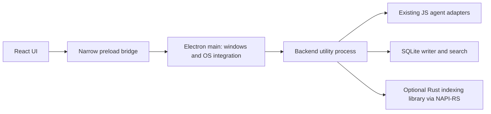

# Tributary: native bridge and startup performance

Historical investigation from 2 November 2026. The observations and proposed implementation phases below describe that snapshot. Several have since been implemented. For current memory work and remaining requirements, see [Memory efficiency](MEMORY_EFFICIENCY.md) and [Memory optimization research](MEMORY_OPTIMIZATION_RESEARCH.md); do not interpret this older inventory as the current implementation status.

Research and working-tree inspection: 2 November 2026.

## Decision

Keep Electron, React, and the current JavaScript agent adapters. First reduce work and data movement on their hot paths. Introduce an asynchronous Rust library through NAPI-RS for a measured indexing/search workload, loaded in an isolated backend process rather than Electron's main process. Keep the JavaScript implementation as a fallback while comparing results.

This is a proposed native architecture. No Rust bridge has been implemented or benchmarked. Startup changes and the vector-logo update are separate, implemented changes described below.

## Actual product and source evidence

The package describes a desktop home for local coding agents. `desktop/main.js` owns a `Hub`, which launches existing CLIs through `core/runner.js` and `core/proc.js`. `core/parsers.js` normalizes their streamed events. The React renderer receives events through the preload bridge. Agent inference happens outside this app; much local work already delegates to compiled programs such as Git and the existing PTY dependency.

| Current code | Observed behavior | Consequence to measure |
| --- | --- | --- |
| `core/store.js`, `Store.save` | Debounces writes for 300 ms, then stringifies and synchronously rewrites the whole state file | Every flush scales with total retained history |
| `desktop/main.js`, `wireEvents` | Coalesces streaming updates over 80 ms, then sends the full growing message | Repeated transfer includes already displayed text and tools |
| `core/memory.js`, `readMemory` | Reads and splits the complete work log before keeping 60 entries | Bounded output still requires work proportional to the log |
| `core/handoff.js`, `digest` | Formats every message before retaining a suffix; adds the first message afterward | Work scales with history; nominal 12,000-character budget can be exceeded |
| `core/hub.js`, `send` and `core/checkpoint.js` | Awaits a full-tree Git checkpoint before starting each turn | Agent-start delay can include a repository scan |
| `ui/src/components/conversation.tsx` | Maps the full transcript; repeatedly copies and reverses prefixes to find preceding prompts | Prompt lookup alone has quadratic total copied elements |
| `ui/src/store.tsx` | Initial conversation loading awaited repository status | Slow Git status delayed the conversation view |
| `core/agents.js` and `desktop/main.js` | Agent version probes were awaited before window creation | External CLI startup could delay the first window |

These are reachable source paths and scaling concerns. They do not establish which dominates a particular user's workload. The UI already has incremental syntax highlighting and the desktop already batches events; retain those optimizations.

## Measurements of current data paths

Reproduce with:

```sh
node scripts/performance/research-baseline.cjs docs/performance/BASELINE.json
```

This calls the existing store, memory reader, and handoff digest with generated fixtures. The committed [raw result](performance/BASELINE.json) records seven warm samples per case, runtime, hardware, and source hashes. On this Linux x64 environment, standalone Node v24.21.0:

| Synthetic workload | Median elapsed time |
| --- | ---: |
| Full store flush, 500 messages / 1.26 MB | 5.245 ms |
| Full store flush, 2,500 messages / 6.29 MB | 31.514 ms |
| Full store flush, 10,000 messages / 25.17 MB | 107.308 ms |
| Digest formatting, 10,000 messages | 7.984 ms |
| Read 100,000 work-log entries / 8.79 MB, return 60 | 15.292 ms |

The digest produced 12,929 characters at 10,000 messages despite its 12,000-character nominal budget. That is a budget-accounting issue rather than a reason to change language.

A separate payload model simulates 1,000 already-coalesced updates, each appending 128 ASCII characters. Sending the full growing message totals 64,177,000 JSON bytes, versus 204,893 bytes for the proposed text-delta envelope, a 313.22:1 payload ratio. This models an unusually long output to expose scaling; it is not a measured Electron speedup. Electron uses structured cloning, and actual payloads, coalescing cadence, patches, and recovery snapshots vary.

Limits: synthetic data, warm filesystem cache, temporary storage, no fsync, no cold-start trace, no actual provider run, no Rust implementation, and no renderer timing. Store timings describe a synchronous call that would occupy its calling JavaScript thread; they do not prove a visible freeze of that duration in a packaged app.

## Where lower-level code can help

| Workload | Initial choice | Reason and promotion condition |
| --- | --- | --- |
| Agent process launch and stream routing | Existing Node adapters | Already delegates to agent executables; measure launch and parsing independently |
| Store updates and transcript search | SQLite in a backend worker/process | Change a row or append events rather than rewriting all history; FTS5 provides native full-text indexing |
| File discovery and exact text search | Existing Git/ripgrep subprocesses first | Reuse proven compiled tools; bundle supported binaries if made a product dependency |
| Large incremental symbol index, ranking, file hashing | Rust + NAPI-RS candidate | Useful only when profiling identifies sustained CPU or allocation pressure |
| JSON event parsing | Existing parser first | Rewriting all vendor adapters adds compatibility work; native parsing needs a demonstrated throughput bottleneck |
| Chat rendering and prompt association | React algorithm/state changes | Reduce copying, precompute associations, limit mounted history, and isolate update subscriptions |
| Remote inference and provider throttling | Context selection and provider behavior | A local Rust bridge does not accelerate a remote model or remove rate limits |

SQLite FTS5 is a lexical search index, not semantic memory. Add embeddings only if task evaluation shows an improvement. With WAL, readers can overlap a writer, but normal SQLite still has one writer at a time. Use bounded write transactions and a writer queue; choose and document durability settings. WAL storage requires a suitable local filesystem. [SQLite FTS5](https://www.sqlite.org/fts5.html), [SQLite WAL](https://www.sqlite.org/wal.html).

## Bridge alternatives

| Option | Suitability for Tributary | Main cost |
| --- | --- | --- |
| JavaScript worker pool | First option for an existing CPU-heavy JavaScript path | Message copying and worker startup; no crash isolation from all native faults |
| Rust via NAPI-RS | Preferred native experiment for the existing Node backend | Per-platform binaries, boundary conversions, native crash and lifecycle handling |
| Persistent Rust sidecar with framed IPC | Alternative if a standalone engine or non-Node host becomes a real requirement | IPC overhead, process supervision, and another distribution artifact |
| C/C++ via Node-API | Appropriate for a specific existing library that needs these bindings | Manual memory ownership and a larger FFI review burden; no evidence it would beat Rust here |
| WebAssembly | Consider for computation shared with a browser-only client | Host calls and memory transfer still need design; does not directly replace desktop filesystem/process work |
| Tauri migration | Separate product/platform evaluation | Replaces the shell, Node runtime assumptions, plugins, packaging, and tests; is not a small bridge |

These are engineering tradeoffs, not a measured language ranking. Tauri uses a Rust core and webviews, but its architecture alone does not establish lower memory or faster startup for Tributary. [Tauri process model](https://v2.tauri.app/concept/process-model/).

## Recommended boundary



Moving the backend is itself a change to measure and test before introducing Rust. Keep OS keychain/dialog access in the main process behind small requests, and send only required credentials to the backend for an explicit launch. Preserve the public core contract where practical. A future VS Code host should use its own process adapter; the supplied folder currently has build-script references to VS Code but no `vscode/` source to validate.

Electron offers a Node-enabled `utilityProcess` with message ports. Keep main-process handlers short and nonblocking. Ordinary filesystem I/O can use Node's asynchronous APIs; workers mainly help CPU-intensive JavaScript. [Electron performance guidance](https://github.com/electron/electron/blob/main/docs/tutorial/performance.md), [utilityProcess](https://www.electronjs.org/docs/latest/api/utility-process), [Node worker threads](https://nodejs.org/api/worker_threads.html).

## Native API design

Proposed JavaScript-facing operations, not existing exports:

```ts
indexChanges({ projectId, generation, paths, operationId }): Promise<IndexResult>
searchIndex({ projectId, generation, query, limit, operationId }): Promise<SearchPage>
getSymbols({ projectId, generation, paths, limit }): Promise<SymbolPage>
cancelOperation(operationId): void
closeIndex(projectId): Promise<void>
```

Resolve project identities to authorized roots in the service; the native layer also checks canonical containment and symlinks. Restrict ignored files, oversized files, and secrets according to explicit product rules. Cap path counts, query length, result bytes, and in-flight operations. Index generations prevent returning results for an old branch or file state.

Batch work across the boundary. Do not call Rust once per token, line, or candidate if one batch suffices. Prefer owned byte buffers or typed numeric arrays where useful, and small result objects; passing a JavaScript object does not automatically become zero-copy. Do not reserialize an entire chat history just to feed a native function.

Use `AsyncTask` for bounded CPU/blocking operations, with owned input and output. Ordinary synchronous native functions still execute on the calling JavaScript thread. A Tokio async function does not make synchronous CPU work nonblocking; use the documented blocking-work mechanism or a bounded dedicated pool. Heavy unbounded jobs must not starve Node's shared worker pool. [NAPI-RS AsyncTask](https://napi.rs/docs/concepts/async-task), [concurrency guide](https://napi.rs/docs/more/async-concurrency).

Provide cooperative cancellation IDs, queue limits, backpressure, and shutdown that drains or cancels owned tasks. Dropping a Promise is insufficient to cancel underlying work. Keep unsafe code out of the first implementation unless a reviewed library requires it. A failed native backend should restart with a fresh index generation and report failure; do not replay a possibly executed agent turn automatically.

Node-API provides ABI stability within its supported API surface, not universal binary compatibility. Select a compatible API level and test the exact Electron runtime, OS, architecture, system-library requirements, and packaging. Ship prebuilt artifacts so end users do not need a Rust compiler. [Node-API](https://nodejs.org/api/n-api.html), [Electron native modules](https://www.electronjs.org/docs/latest/tutorial/using-native-node-modules).

## Order of work

1. **Startup changes implemented in this working tree:** create the window before awaiting discovery; publish located agents before version probing; show a discovery state; coalesce simultaneous scans; render the conversation without waiting for Git status. Local desktop traces are recorded below; supported-platform and cold-start measurements remain future work.
2. **Trace the real app:** record process entry, app ready, window visible, renderer mounted, restored thread visible, first usable agent, agent spawn, and first provider event. Distinguish startup from first-response time.
3. **Reduce repeated work:** incremental persistence; bounded work-log tail; one-pass prompt association; strict handoff budgeting; streaming deltas with sequence numbers and snapshot recovery. Preserve final flush and error/stop events.
4. **Isolate backend work:** utility process with versioned messages, cancellation, restart reporting, and tests that no active turn silently runs twice.
5. **Prototype one Rust workload:** incremental file/symbol indexing on the same corpus, returning the same results as the JavaScript/reference path. Measure the whole boundary and indexing task.
6. **Release only with evidence:** require parity, meaningful end-to-end latency or responsiveness gains, acceptable memory, and packaged tests across supported targets. Keep a fallback and a diagnostic switch.

Checkpoint optimization deserves its own comparison. Git already performs compiled work here. Measure large repositories, untracked files, submodules, concurrent project activity, and unchanged trees before changing snapshot semantics. Do not speed up launch by silently weakening restore guarantees.

## Evaluation gates

Use small/medium/large projects, 500/2,500/10,000-message histories, noisy terminal output, one and several simultaneous agents, cold/warm launches, and real user-data storage. Compare current JS, improved JS, and native candidates with identical output checks.

Collect median and p95 launch milestones, main-process event-loop delay, renderer input latency, CPU, peak and steady-state RSS across the process tree, bytes transferred, indexing time, search time, and time to a validated coding result. Sample sizes and hardware must be reported; no p95 claim should come from the seven-sample microbenchmark above.

For example, if 90% of a task is provider wait and 10% is local work, making all local work ten times faster yields only `1 / (0.90 + 0.10 / 10) = 1.099`, about 10% overall speedup. This hypothetical calculation explains why smaller context and fewer repeated agent steps can matter more than a native rewrite.

## Logo change

The existing editable vector was refined directly: a flat indigo tile and three consistent-width streams joining one flow. SVG remains the UI source; 16/32/128/256/512-pixel desktop variants and the favicon were regenerated locally. No generated bitmap or extra runtime library is needed. The [preview](performance/logo-preview.png) and the application assets use the same geometry.

## Desktop startup result and validation

The [raw startup traces](performance/STARTUP.json) contain three runs per variant on Linux x64, Electron 44.7.2, an explicit X11 virtual display, GPU disabled, fresh temporary application profiles, and warm system caches. The comparison reconstructs the previous await-initialization startup gate while sharing the same current core, built UI, and assets. It is not a historical release comparison or cold-boot test.

| Milestone | Before, median | After, median |
| --- | ---: | ---: |
| Electron app ready → window ready to show | 3,185.048 ms | 622.244 ms |
| JavaScript main entry → window ready to show | 3,305.842 ms | 854.433 ms |

The first interval decreased approximately 80.5%. It does not include Electron startup before JavaScript main entry and does not measure when a provider starts replying. The three after intervals were 618.872, 726.190, and 622.244 ms; the three before intervals were 3,185.048, 3,586.145, and 3,005.520 ms. These are too few samples for a reliable p95 estimate.

Validation completed:

- All 40 repository tests pass, including two new tests for discovery without version execution, early usable-agent publication, and sharing overlapping scans.
- The production UI build and TypeScript no-emit check pass.
- The desktop smoke test loads the real UI, reports the desktop bridge with no reported startup error, and discovers four installed agents. It makes no coding/provider request. A [screenshot](performance/desktop-smoke.png) shows the logo in the sidebar and empty state.
- SVG sources match the built assets, and PNG dimensions were verified at each exported size.

The restricted sandbox blocked test child processes and Git. The full suite passed with normal host process access. The first virtual-display attempt selected Wayland and stalled; its temporary processes were stopped, then the X11 smoke and startup comparisons passed. Application sandbox settings were preserved.

Git metadata is unavailable in this workspace, so no commit or repository diff check was possible. The Rust bridge, storage migration, stream-delta protocol, and other planned improvements remain unimplemented.
