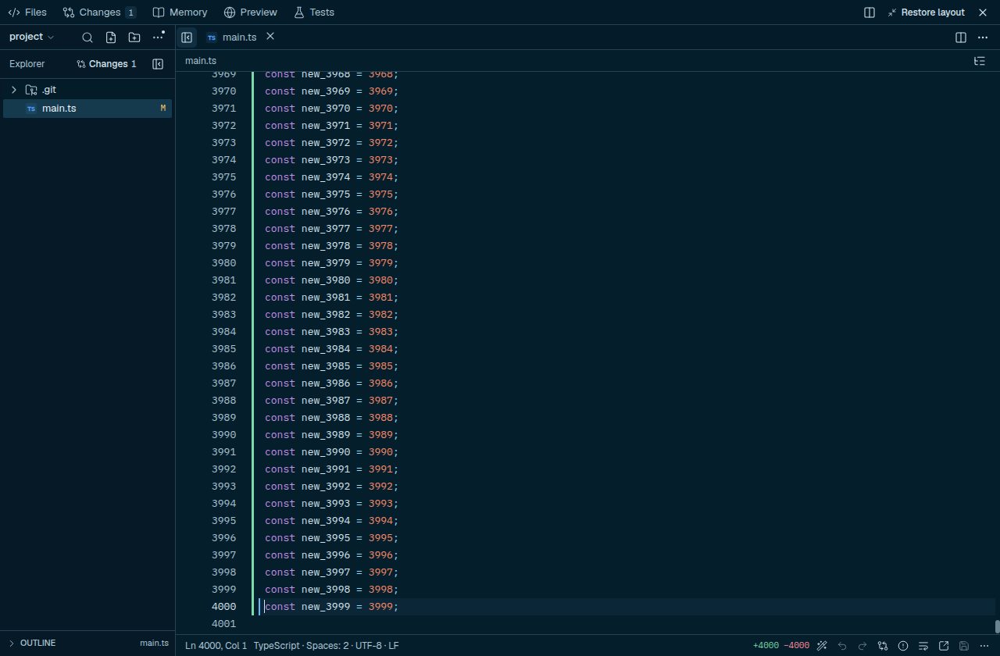

# Editor diff scan: complete coverage with less temporary work

The editor previously called the bounded diff-review parser to obtain gutter markers, then separately split the complete patch again to count additions/deletions. The review parser also built display rows, source substrings and side-by-side columns that the gutter never used. Its 2,000-row presentation limit silently omitted later editor changes. A 4,000-line replacement produced one incomplete deletion marker and no addition markers.

The editor now scans the supplied patch once for both annotations and statistics. Only hunk headers require small substrings; source-body lines and review columns are not materialized. Statistics-only callers create no marker map. Hunk counts distinguish real added/removed content from file headers, including source lines beginning with `++` or `--`. Untracked and binary results follow the actual file-diff producer. The bounded **review UI** keeps its existing limit; it no longer limits editor metadata.



## Equal-output parser measurements

[Raw results](editor-diff-benchmark.json) preserve all 60 fresh subprocesses: five fixtures, three alternating baseline/candidate pairs, and separate timing versus allocation-sampling phases. Baseline source is `fdcf3b18f7b4acefaa5784a80554d7ed35d15657`; candidate source hashes are recorded. Both variants receive identical materialized input and must return exactly equal results in every compared case. Tests and builds finished before this serial measurement.

| Fixture | Calls per process | Median call, old → scan (ms) | Sampled scanner allocation, old → scan (MiB) |
| --- | ---: | ---: | ---: |
| One small hunk | 5,000 | 0.00525 → 0.00176 | 34.17 → 3.46 |
| 64 separated hunks | 1,500 | 0.12694 → 0.04384 | 297.90 → 36.94 |
| 700-line replacement | 800 | 0.42938 → 0.17222 | 587.72 → 78.47 |
| 64 hunks with long source lines | 400 | 1.50841 → 0.13563 | 80.56 → 9.98 |
| Full statistics for a 20,000-line replacement | 100 | 2.86464 → 1.20224 | 366.34 → 0.031 |

These are medians across three process-level observations. Allocation totals cover the stated repeated calls, not bytes retained by one result. The 16 KiB sampling interval makes tiny residual totals approximate; 0.031 MiB does not establish zero allocation. Sampling includes collected objects and reports allocations under scanner/review-parser stack frames. Timing and observed natural GC run in separate unprofiled subprocesses. Initial/final diagnostic collection is outside measured work and is never added to the app.

Observed natural collection counts decrease in these fixtures (for the dense case, median 92 → 31), but these small isolated loops do not establish universally lower GC pauses. Raw per-call p95, CPU time, GC events, sampled totals and observed heap high-water readings remain in the report. Node 24.21.0/V8 versions and all observations are retained. No case is discarded or rerun to select a result.

## Coverage is separate from performance

The full 20,000-line replacement returns **one incomplete marker before versus 20,000 complete markers after**, including the final line. That output is deliberately different and is **excluded** from the equal-output allocation/timing comparison. The `largeStats` case measures only the identical complete numeric counts. Complete large marker sets can retain more memory than the old incorrect truncation; compact marker/range ownership remains future work.

No source text, undo history or supplied patch is discarded. Existing Git-patch byte limits and editor text-size limits remain unchanged. This does not measure process PSS/RSS, peak whole-app RAM, hardware cache misses, native/GPU memory, local-model inference or end-to-end editor latency. The earlier cross-editor navigation cohort remains frozen and does not measure this implementation.

## Reading and validation

The author-hosted [Data Locality chapter of Game Programming Patterns](https://gameprogrammingpatterns.com/data-locality.html) informed separating frequently needed counts from display-only structures. [Reading provenance](editor-diff-reading.json) records the full captured chapter text and C++ listings reviewed, 6,403 captured words and content hash. Diagrams were not visually inspected; C++ examples, exercises and linked papers were not executed/reviewed. This is not the whole book. Its native-layout arguments are not assumed to prove V8 cache behavior; measured JavaScript allocation/work is the evidence here.

[Verification](editor-diff-verification.json): 647 regression tests, 26 focused tests, TypeScript and production UI build pass. Five native Linux checks use real Git, CodeMirror, native undo and actual watched file writes; the final source-line gutter marker and refreshed counts are visible. This is not macOS/Windows UI certification.

```sh
npm run bench:editor-diff -- /tmp/editor-diff-benchmark.json
xvfb-run -a node_modules/.bin/electron test/e2e/editor-diff.cjs --ozone-platform=x11
```
