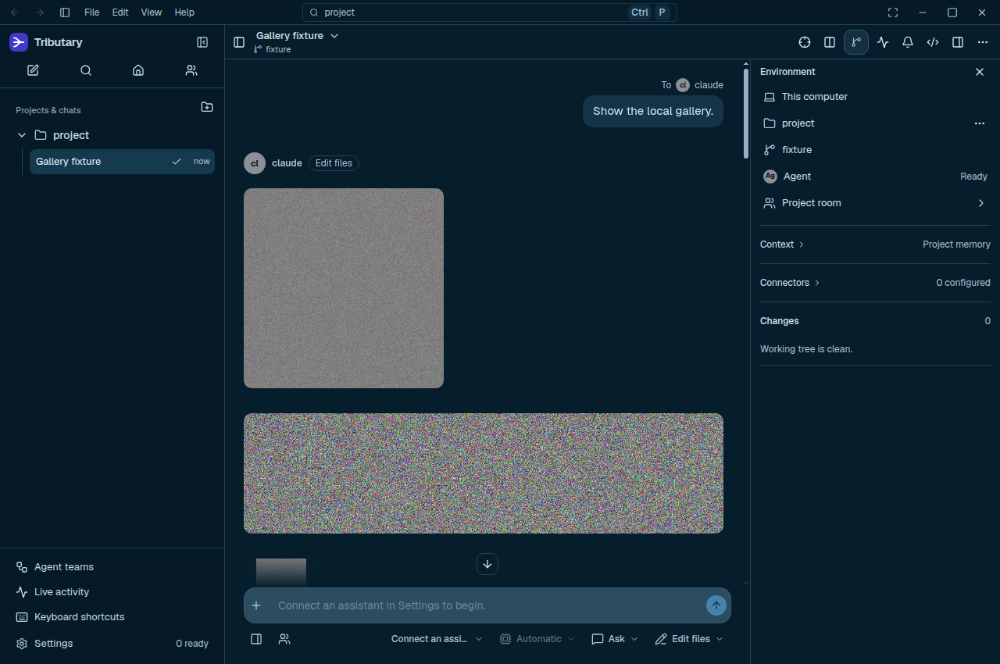

# Explicitly owned gallery pixels

Status: base64-transport intermediate, not published. Superseded for further investigation by the [binary-image bridge](BINARY_IMAGE_BRIDGE.md). Its source is preserved in the [reproducible patch against 25c7173](owned-pixels-base64-prototype.patch.gz). The previous encoded-thumbnail candidate is preserved as a [rejected experiment](ENCODED_RENDITION_PROTOTYPE.md): its four-cycle savings disappeared by twenty cycles. Those measurements must not be attributed to this implementation.

## Resource lifetime

Local Markdown and chat cards use an explicitly owned pixel surface for eligible static JPEG and 8-bit PNG images. The decoder's original and resized ImageBitmaps close after materializing the card surface. The shared resource lease owns that surface until the last visible, focused or dialog-pinned card releases it. Each displayed canvas also resets its backing dimensions during cleanup. Duplicate references share the source surface; rendering one duplicate does not consume another's bitmap. There is no encoded-thumbnail Blob or extra IMG decode for these cards.

The source dimensions determine layout and placeholders. Card backing dimensions retain at least 2x density, increase with display density up to 4x, never upscale, and fit a 1,024-by-256 CSS-pixel box. Large images already inside that box also use an owned surface. Tiny PNGs (both axes at most 64 pixels) bypass native bitmap work by their header; other tiny decoded static images stay on the original path. Image files are never rewritten.

Full-image dialogs and editor previews still use original bytes, separately from the card lease. Animated and unknown formats, 16-bit PNG and HDR PNG metadata keep the browser's original image path. Missing bitmap/OffscreenCanvas/transfer/context APIs and decode failures fall back to the original path. SVG and remote-image behavior remain explicit. Read/decode admission still has two shared slots and the existing 128-key admission ceiling. Cancelled and late results close produced surfaces without publishing into replacement owners. Bridge file responses are dropped before awaiting native decode rather than being retained just for their size and modification time.

## Functional verification

The candidate has passed twenty-three focused lifetime/rendition/visibility regressions, TypeScript and a production UI build. A complete run passed all 681 regressions. A fresh native verification passed all four cases (41 grouped checks), including missing-observer and missing-bitmap fallbacks. One preceding missing-bitmap resize check [timed out](owned-pixels-verification-first-failure.json), leaving an [incomplete first report](owned-pixels-verification-first.json); an unchanged-code rerun with added failure diagnostics passed without weakening assertions. The longer comparison and all eighteen fresh short-run apps are complete. The short-run result below prevents a release claim. No memory improvement is claimed from these functional or bundle checks alone.



The screenshot is a deterministic synthetic image fixture, not user content. The square and wide cards keep their original display geometry; exact full-source pixels and formats are checked separately in the native functional record.

## Twenty-cycle lifetime comparison

[Raw measurements and source/build/harness fingerprints](owned-pixels-long.json) compare published-source commit `25c71737476a42c0f8ee996b1ea007e7efd869cb` with this candidate using identical deterministic PNG files and dependencies. Each side uses one fresh private Linux/Xvfb Electron 44.7.2 process tree. Sixteen image tiles include square, wide, tall and tiny PNGs. Both sides complete 641 decoded-card visits, twenty forward/reverse cycles, a bottom revisit and gallery removal/settling. All 50 process-tree samples are complete. No forced collection, pixel hashes, canvas pixel reads or full-image dialogs run in this memory cohort.

| App-tree proportional resident memory, MiB | Before | Candidate |
| --- | ---: | ---: |
| Initial checkpoint | 464.65 | 480.49 |
| After cycle 4 | 965.14 | 587.24 |
| After cycle 20 | 921.51 | 525.82 |
| After removal and settling | 906.89 | 500.39 |
| Largest sampled checkpoint | 1213.37 | 797.87 |

The final checkpoint is 406.50 MiB lower in this pair (44.8%). The initial checkpoint is 15.84 MiB higher. This is sampled PSS, not a continuous peak or a guarantee of a memory plateau. Renderer used heap at the final checkpoint is higher, 59.27 → 110.73 MiB, even while total observed resident memory is lower. Explicit graphics ownership addresses a native-image cost; JavaScript heap alone would not establish this result.

Summed scroll-request-to-decoded-DOM time over 641 visits is 11.41 → 5.41 seconds in this pair; median individual visit time is 3.03 → 2.45 ms. These intervals include automation, IPC and polling, exclude fixed waits and are not input-to-paint latency. One baseline-first pair cannot establish general throughput or repeatability. The candidate's early cycle-2 PSS is 797.87 MiB before later automatic collection; explicit bitmap disposal does not remove all transient allocation or allocator capacity.

[Native functional record](owned-pixels-verification.json) is separate from these timings and memory measurements. [Dependency-closure audit](owned-pixels-bundles.json) reports +3,442 minified JavaScript bytes for both cold chat and workspace entry closures (+1,195/+1,196 gzip bytes respectively). Editor/settings/team features remain lazy. Bundle bytes do not measure RAM or startup latency.

## Complete shorter-run cohort: release held

[All eighteen fresh apps](owned-pixels-memory.json) provide 216 complete process-tree samples: three alternating pairs each for tiny-image ordinary, sixteen-image ordinary and sixteen-image diagnostic cases. Both sides complete four forward/reverse cycles, bottom revisit, removal and settling. Ordinary and explicit renderer-GC cases use separate processes. No other test/build/native benchmark ran concurrently.

| Final checkpoint, median of three | Before | Explicit pixels with base64 |
| --- | ---: | ---: |
| Tiny ordinary app-tree PSS, MiB | 330.04 | 330.52 |
| Gallery ordinary app-tree PSS, MiB | 944.48 | 998.09 |
| Gallery ordinary renderer used heap, MiB | 72.51 | 359.64 |
| Gallery diagnostic app-tree PSS, MiB | 825.88 | 344.45 |
| Gallery diagnostic renderer used heap, MiB | 7.51 | 7.59 |

Ordinary gallery final paired PSS differences are +84.22, +157.56 and −358.36 MiB. The candidate has a much smaller diagnostic retained working set, but its ordinary heap and short-run PSS are not reliably lower. In the first two ordinary candidate runs, renderer used heap ends at 359.64 and 397.57 MiB; the third ends at 153.95 MiB. All tiles/canvases/Blob URLs are gone after removal. This is consistent with substantial transient allocation before automatic collection; it does not by itself prove the exact retainer path or justify forced production GC.

The long-run saving is real for that recorded pair, but is insufficient to ship a generally memory-oriented result. The next experiment removes desktop base64 representation churn rather than hiding these unfavorable ordinary samples. Neither a diagnostic collection nor the best individual ordinary run is substituted for the whole cohort.

## Reproduction

Use a separate build of baseline commit `25c71737476a42c0f8ee996b1ea007e7efd869cb`, the same dependency versions and a production build of this candidate. Pass the baseline checkout's absolute path as the first argument. The probes run source Electron in private Xvfb profiles, not the packaged installers. Do not run builds/tests alongside memory measurements or change their source/built JavaScript between checkpointed cases.

```sh
node scripts/performance/rendition-images.cjs /absolute/baseline /tmp/gallery-memory.json
node scripts/performance/rendition-images.cjs /absolute/baseline /tmp/gallery-verification.json verify
node scripts/performance/rendition-long.cjs /absolute/baseline /tmp/gallery-long.json baseline
node scripts/performance/rendition-long.cjs /absolute/baseline /tmp/gallery-long.json optimized
node scripts/performance/rendition-bundles.mjs /tmp/gallery-bundles.json
```

The memory matrix completes eighteen fresh apps: three alternating-order pairs for tiny-image ordinary, sixteen-image ordinary and sixteen-image diagnostic cohorts. The functional matrix is separate. `TRIBUTARY_BENCH_CASE_LIMIT=2` limits a matrix invocation to two new cases; append `--resume` to continue the same report, whose source/build/harness/image identities must still match. A timeout does not justify restarting a live probe or treating its partial report as complete.

## Reading

[MDN's transferToImageBitmap guidance](https://developer.mozilla.org/en-US/docs/Web/API/OffscreenCanvas/transferToImageBitmap#description), read 7 November 2026, distinguishes consumption from drawing and warns that dropping an ImageBitmap reference leaves graphics resources until collection. [ImageBitmap.close](https://developer.mozilla.org/en-US/docs/Web/API/ImageBitmap/close) documents explicit graphical-resource disposal. These are scoped API readings, not a claim to have read every memory-management book. The shared-card design uses non-consuming drawing with explicit last-owner close; full fidelity, selection/focus behavior and native working-set measurements remain separate requirements.

No production forced collection, memory-pressure API, arbitrary heap ceiling, new dependency or native-language bridge is introduced. Source Electron/Xvfb measurements do not certify Windows/macOS, hardware-GPU, model VRAM or the complete application. Attachments, full-image viewer native caches, dirty/undo working sets and runtime-owned model memory remain part of the broader active optimization goal.

Archived source patches use deterministic gzip compression. Decompress with `gzip -dc path/to/prototype.patch.gz | git apply -` inside the clean baseline checkout before building that historical candidate. Both archives passed a clean-baseline apply check after decompression.
